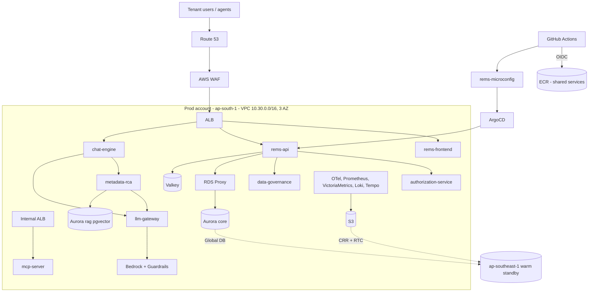

# REMS-AWS-Architecture

**REMS on AWS: production infrastructure architecture and implementation.** A multi-account AWS platform for REMS, an enterprise observability and reliability management platform, delivered as Terraform, Kubernetes manifests, Helm charts, GitOps pipelines, policies, runbooks and a full step-by-step implementation guide in [`docs/`](docs/README.md).

> **Status:** all infrastructure code is written and validated **offline**. **Nothing has been deployed to AWS**, and no AWS resources exist yet. Application-specific values (container ports, health routes, env var names, API paths) and all account IDs, domains and ARNs are **placeholders**, because the service repositories and real account data weren't available. See [`documentation/02-assumptions.md`](documentation/02-assumptions.md) and [`docs/IMPLEMENTATION-STATUS.md`](docs/IMPLEMENTATION-STATUS.md).

---

## 1. Introduction

The repository answers the *Cloud Infrastructure Architecture Design Challenge, REMS* problem statement. Every requirement is traced in [`documentation/01-requirements-checklist.md`](documentation/01-requirements-checklist.md). It contains the design ([`architecture/`](architecture/README.md)), the implementation (Terraform, Kubernetes, Helm, CI/CD, policies), operations material ([`runbooks/`](runbooks/README.md)) and the implementation guide ([`docs/`](docs/README.md)).

## 2. Business requirements

| Requirement (problem statement) | Target | How it is met |
|---|---|---|
| Availability | 99.95 % | 3-AZ everything, PDBs, readiness gates, Aurora/Valkey Multi-AZ, canary + auto-rollback, SLO burn-rate alerting |
| Single-AZ failure | Automatic recovery | Static stability (NAT/endpoints per AZ), ALB health checks, Karpenter re-provisioning, 60 s eviction, Aurora/Valkey failover. Drill with AWS FIS |
| Disaster recovery | RPO 15 min / RTO 2 h | Aurora Global Database, S3 CRR with RTC, replicated secrets and images, warm-standby EKS in ap-southeast-1, ~75 min runbook |
| Scale | 20 → 100+ tenants, 50 M events/day, 5× peaks | KEDA/HPA + Karpenter, separate OLTP and vector clusters, RDS Proxy, per-tenant limits |
| Tenant isolation | No cross-tenant access | JWT tenant → OPA → PostgreSQL RLS (FORCE) → telemetry tenant headers → S3 prefixes |
| Environments | dev, staging, prod | Plus prod-dr |
| Telemetry retention | 30–90 days | Loki 30 d (90 d per tenant), Tempo 30 d, VictoriaMetrics 90 d |
| Cost awareness | – | Graviton + Spot, I/O-Optimized Aurora, lifecycle tiering, LLM budgets. Estimate: **~26.6k USD/month on-demand for all environments, ~20.6k optimized** (`scripts/cost_model.py`, approximate list prices) |

## 3. Technology stack

| Layer | Technology |
|---|---|
| Cloud | AWS: Organizations/SCPs, VPC, EKS 1.31, EC2 (Graviton), ALB, WAF, Route 53, ACM, ECR, Aurora PostgreSQL 16 + RDS Proxy, ElastiCache Valkey 7.2, S3, KMS, Secrets Manager, Cognito, Bedrock + Guardrails, CloudWatch, GuardDuty, Security Hub, Inspector, AWS Backup, FIS |
| IaC | Terraform ≥ 1.10 (AWS provider ~> 5.80), S3 backend with native locking |
| Kubernetes | Kustomize, Karpenter, AWS Load Balancer Controller, External Secrets, external-dns, KEDA, metrics-server, Kyverno, Argo Rollouts |
| Packaging | Helm 3: `rems-common` library chart + 7 service charts |
| CI/CD | GitHub Actions (OIDC), Trivy, SonarQube, hadolint, cosign, SBOM, ArgoCD (ApplicationSets, multi-source), `rems-microconfig` GitOps repo |
| Observability | OpenTelemetry Collector, kube-prometheus-stack, VictoriaMetrics, Loki, Tempo, Grafana, CloudWatch |
| AI | LiteLLM gateway, Amazon Bedrock (Claude, Titan embeddings), pgvector, MCP server with OPA policy |
| Policy | OPA/Rego, Kyverno, Pod Security Admission |
| Testing | k6 + k6-operator, AWS FIS, kubeconform, Checkov, tflint, actionlint, promtool, shellcheck |

## 4. Architecture overview

Seven REMS services run on EKS in a 3-AZ VPC per environment, behind Route 53, WAF and an ALB. They are backed by two Aurora PostgreSQL clusters (OLTP and pgvector), a Valkey cluster and S3, with Bedrock behind an LLM gateway. Delivery is GitOps: CI pushes signed images to ECR and bumps tags in `rems-microconfig`, ArgoCD syncs, and Argo Rollouts canaries with automatic analysis. A warm standby runs in ap-southeast-1.

Details: [docs/01-architecture](docs/01-architecture/overview.md) · design docs: [architecture/](architecture/README.md).

## 5. Architecture diagram



All ten detailed diagrams: [docs/01-architecture/architecture-diagrams.md](docs/01-architecture/architecture-diagrams.md).

## 6. Repository structure

```text
REMS-AWS-Architecture/
├── docs/                step-by-step implementation guide (this README links every page), status, changelog
├── architecture/        10 design documents with Mermaid diagrams
├── terraform/
│   ├── landing-zone/    Organizations, OUs, accounts, SCPs, org CloudTrail, delegated security services
│   ├── global/          bootstrap (state, boundaries, GitHub OIDC) · shared-services (ECR)
│   ├── modules/         17 modules (vpc, eks, karpenter, pod-identity, ecr, aurora-postgresql, elasticache-redis, s3-bucket,
│   │                    kms, waf, monitoring, security-baseline, github-oidc, cognito, ai-platform, backup, rems-environment)
│   ├── environments/    dev · staging · prod · prod-dr
│   └── cicd/            github (microconfig repo, CI settings) · argocd (ArgoCD + ApplicationSet per cluster)
├── kubernetes/          base · overlays/<env> · platform-addons/<addon> values
├── helm/                rems-common library + 7 service charts · environments/<env>/global.yaml
├── cicd/                ArgoCD install/projects/bootstrap/apps · Argo Rollouts analysis · microconfig repo template
├── .github/workflows/   app-build · terraform · k8s-validate · security-scan · load-test
├── security/            SCPs, permission boundaries, Kyverno, OPA (+tests), threat model, audit logging, secrets rotation
├── monitoring/          kube-prometheus-stack, Loki, Tempo, OTel Collector, VictoriaMetrics, rules, dashboards, SLOs
├── database/            SQL (roles, grants, RLS, pgvector) · bootstrap / rotation / PITR / failover scripts · Redis design
├── ai-infrastructure/   LLM gateway, RAG design, MCP tool catalog
├── load-testing/        k6 scenarios · k6-operator · AWS FIS chaos
├── scripts/             validate.sh · bootstrap-cluster.sh · smoke-test.sh · cost_model.py · offline checkers
├── runbooks/            12 operational runbooks
└── documentation/       requirements, assumptions, deployment matrix, deployment guide, capacity plan, cost model, roadmap
```

## 7. Prerequisites

| Item | Version / note |
|---|---|
| AWS | An AWS Organization management account. Identity Center. Quotas for EIPs, vCPUs and endpoints |
| Terraform | ≥ 1.10 (CI pins 1.10.3) |
| AWS CLI | v2 with Identity Center profiles (`rems-<env>-admin`) |
| kubectl / kustomize / Helm | 1.31 / 5.x / 3.16 |
| gh, argocd, jq, yq, psql 16, k6 | current |
| GitHub | Org admin to create `rems-microconfig`, a GitHub App `rems-config-bot`, environments and variables |
| Optional (validation) | kubeconform, actionlint, opa, promtool, checkov, tflint, shellcheck, yamllint |

## 8. Getting started

```bash
git clone https://github.com/<github-user>/<repo-name>.git
cd <repo-name>
./scripts/validate.sh                 # offline validation, no AWS access needed
grep -rn PLACEHOLDER --include=*.tf --include=*.tfvars --include=*.hcl --include=*.yaml . | wc -l   # values to replace
```

Then follow [docs/14-operations/deployment-runbook.md](docs/14-operations/deployment-runbook.md).

## 9. Terraform deployment

```bash
# order: landing-zone -> global/bootstrap -> global/shared-services -> cicd/github -> environments/<env> -> prod-dr -> cicd/argocd
cd terraform/environments/dev
export AWS_PROFILE=rems-dev-admin
terraform init -backend-config=backend.hcl
terraform plan -out=tfplan
terraform apply tfplan          # creates billable resources - only with approval
```

Guide: [docs/02-aws-infrastructure/infrastructure-deployment.md](docs/02-aws-infrastructure/infrastructure-deployment.md), [docs/03-terraform](docs/03-terraform/terraform-deployment.md).

## 10. EKS access

```bash
aws sso login --profile rems-prod-admin
aws eks update-kubeconfig --region ap-south-1 --name rems-prod --alias rems-prod --profile rems-prod-admin
kubectl get nodes -L topology.kubernetes.io/zone,karpenter.sh/nodepool
```

The API endpoint is private in staging/prod/DR (VPN in `private_api_allowed_cidrs`, or an SSM bastion). Access is through EKS access entries (PlatformAdmin, ReadOnly, OnCall, CI). Guide: [docs/02-aws-infrastructure/eks-setup.md](docs/02-aws-infrastructure/eks-setup.md).

## 11. Helm / application deployment

Services are deployed by ArgoCD (charts from this repo, values from `rems-microconfig`). Never install them with `helm install` by hand.

```bash
cd terraform/cicd/argocd && terraform init -backend-config=backends/prod.hcl && terraform apply -var-file=envs/prod.tfvars
# or: ./scripts/bootstrap-cluster.sh prod
helm template rems-api helm/charts/rems-api -n rems \
  -f helm/charts/rems-api/values-prod.yaml -f helm/environments/prod/global.yaml   # local render only
```

Guide: [docs/05-helm/application-deployment.md](docs/05-helm/application-deployment.md).

## 12. CI/CD workflow

PR merge → date tag `YYYY.MM.DD-<run>` → hadolint → buildx (amd64 + arm64) → Trivy gate → push to ECR → SBOM + cosign → PR to `rems-microconfig` (`apps/<svc>/values-dev.yaml`) → auto-merge → ArgoCD sync → Argo Rollouts canary with analysis. Promotion to staging/prod uses `promote.yml` (same digest, CODEOWNER approvals). Rollback uses `rollback.yml`.

Guide: [docs/06-cicd/deployment-workflow.md](docs/06-cicd/deployment-workflow.md).

## 13. Monitoring access

```bash
kubectl -n monitoring port-forward svc/kube-prometheus-stack-grafana 3000:80        # Grafana (SSO)
kubectl -n monitoring port-forward svc/kube-prometheus-stack-prometheus 9090:9090   # Prometheus
kubectl -n monitoring port-forward svc/kube-prometheus-stack-alertmanager 9093:9093 # Alertmanager
```

Dashboards: `rems-slo-overview`, `rems-service-red`, `rems-ai-gateway`. Out-of-band CloudWatch alarms page through SNS even when the cluster is down. Guide: [docs/09-monitoring](docs/09-monitoring/prometheus.md).

## 14. Security implementation

SCPs and permission boundaries · no IAM users or keys (OIDC + Identity Center + Pod Identity) · KMS CMKs per data domain · Secrets Manager + External Secrets (file mounts) · PSA restricted + Kyverno (signed images, hardening) · default-deny NetworkPolicies · WAF · tenant isolation in five layers · read-only MCP with an OPA tool policy · GuardDuty / Security Hub / Inspector · threat model in [`security/threat-model.md`](security/threat-model.md). Guide: [docs/07-security](docs/07-security/iam-security.md).

## 15. HA / DR

3-AZ HA for every tier. Warm standby in ap-southeast-1 with Aurora Global Database, S3 CRR + RTC, and secret/image replication. 📋 Route 53 failover records are still to be added. Guide: [docs/11-ha-dr](docs/11-ha-dr/high-availability.md). Runbook: [`runbooks/dr-regional-failover.md`](runbooks/dr-regional-failover.md).

## 16. Troubleshooting

[docs/14-operations/troubleshooting.md](docs/14-operations/troubleshooting.md) (symptom index) · [Terraform](docs/03-terraform/troubleshooting.md) · [Kubernetes](docs/04-kubernetes/troubleshooting.md) · [runbooks](runbooks/README.md).

## 17. Validation performed (offline)

| Check | Result |
|---|---|
| Terraform HCL parse + module wiring (26 directories) | ✅ |
| Checkov Terraform | 1 428 passed, 0 failed |
| Helm: 7 charts × 4 environments rendered + kubeconform strict | 28/28 ✅ |
| Kustomize overlays + kubeconform | 172 objects ✅ |
| Checkov rendered Kubernetes | 771 passed, 0 failed |
| OPA tests · promtool (114 rules) · actionlint · shellcheck · SQL parser · k6 inspect (7) · Mermaid | ✅ |
| `terraform validate`, `helm lint`, Kyverno CLI with real binaries | CI only (not run in the build environment) |

Details: [docs/12-testing](docs/12-testing/terraform-validation.md).

## 18. Documentation navigation

**Start here:** [docs/README.md](docs/README.md) · [Implementation status](docs/IMPLEMENTATION-STATUS.md) · [Changelog](docs/CHANGELOG.md)

| Section | Pages |
|---|---|
| 01 Architecture | [Overview](docs/01-architecture/overview.md) · [AWS](docs/01-architecture/aws-architecture.md) · [Network](docs/01-architecture/network-architecture.md) · [EKS](docs/01-architecture/eks-architecture.md) · [Application](docs/01-architecture/application-architecture.md) · [Database](docs/01-architecture/database-architecture.md) · [Diagrams](docs/01-architecture/architecture-diagrams.md) |
| 02 AWS infrastructure | [Account setup](docs/02-aws-infrastructure/aws-account-setup.md) · [IAM](docs/02-aws-infrastructure/iam-configuration.md) · [VPC](docs/02-aws-infrastructure/vpc-setup.md) · [Subnets](docs/02-aws-infrastructure/subnet-configuration.md) · [Security groups](docs/02-aws-infrastructure/security-groups.md) · [VPC endpoints](docs/02-aws-infrastructure/vpc-endpoints.md) · [EKS](docs/02-aws-infrastructure/eks-setup.md) · [Deployment order](docs/02-aws-infrastructure/infrastructure-deployment.md) |
| 03 Terraform | [Installation](docs/03-terraform/installation.md) · [Structure](docs/03-terraform/project-structure.md) · [Backend](docs/03-terraform/backend-configuration.md) · [Modules](docs/03-terraform/modules-explanation.md) · [Environments](docs/03-terraform/environment-configuration.md) · [Deployment](docs/03-terraform/terraform-deployment.md) · [Troubleshooting](docs/03-terraform/troubleshooting.md) |
| 04 Kubernetes | [Cluster](docs/04-kubernetes/cluster-configuration.md) · [Namespaces](docs/04-kubernetes/namespaces.md) · [Deployments](docs/04-kubernetes/deployments.md) · [Services](docs/04-kubernetes/services.md) · [Ingress](docs/04-kubernetes/ingress.md) · [Autoscaling](docs/04-kubernetes/autoscaling.md) · [Network policies](docs/04-kubernetes/network-policies.md) · [Troubleshooting](docs/04-kubernetes/troubleshooting.md) |
| 05 Helm | [Installation](docs/05-helm/helm-installation.md) · [Chart structure](docs/05-helm/chart-structure.md) · [Values](docs/05-helm/values-configuration.md) · [Application deployment](docs/05-helm/application-deployment.md) |
| 06 CI/CD | [GitHub Actions](docs/06-cicd/github-actions.md) · [Docker build](docs/06-cicd/docker-build.md) · [ECR](docs/06-cicd/ecr-integration.md) · [Security scanning](docs/06-cicd/security-scanning.md) · [ArgoCD](docs/06-cicd/argocd-setup.md) · [Workflow](docs/06-cicd/deployment-workflow.md) · [Rollback](docs/06-cicd/rollback-procedure.md) |
| 07 Security | [IAM](docs/07-security/iam-security.md) · [Secrets](docs/07-security/secrets-management.md) · [Encryption](docs/07-security/encryption.md) · [Containers](docs/07-security/container-security.md) · [Kubernetes](docs/07-security/kubernetes-security.md) · [Tenant isolation](docs/07-security/tenant-isolation.md) · [MCP](docs/07-security/mcp-security.md) |
| 08 Database | [PostgreSQL](docs/08-database/postgresql-setup.md) · [Redis](docs/08-database/redis-setup.md) · [Backup & restore](docs/08-database/backup-and-restore.md) · [Pooling](docs/08-database/connection-pooling.md) · [DR](docs/08-database/disaster-recovery.md) |
| 09 Monitoring | [Prometheus](docs/09-monitoring/prometheus.md) · [Grafana](docs/09-monitoring/grafana.md) · [Loki](docs/09-monitoring/loki.md) · [Tempo](docs/09-monitoring/tempo.md) · [OpenTelemetry](docs/09-monitoring/opentelemetry.md) · [Alerting](docs/09-monitoring/alerting.md) · [Dashboards](docs/09-monitoring/dashboards.md) |
| 10 AI infrastructure | [Architecture](docs/10-ai-infrastructure/ai-architecture.md) · [RAG](docs/10-ai-infrastructure/rag-implementation.md) · [pgvector](docs/10-ai-infrastructure/pgvector.md) · [LLM integration](docs/10-ai-infrastructure/llm-integration.md) · [MCP server](docs/10-ai-infrastructure/mcp-server.md) |
| 11 HA / DR | [High availability](docs/11-ha-dr/high-availability.md) · [Disaster recovery](docs/11-ha-dr/disaster-recovery.md) · [Backup strategy](docs/11-ha-dr/backup-strategy.md) · [Recovery runbook](docs/11-ha-dr/recovery-runbook.md) |
| 12 Testing | [Terraform](docs/12-testing/terraform-validation.md) · [Helm](docs/12-testing/helm-validation.md) · [Application](docs/12-testing/application-testing.md) · [k6](docs/12-testing/k6-load-testing.md) · [Failure scenarios](docs/12-testing/failure-scenarios.md) |
| 13 Cost | [Estimation](docs/13-cost-optimization/aws-cost-estimation.md) · [Breakdown](docs/13-cost-optimization/cost-breakdown.md) · [Optimization](docs/13-cost-optimization/optimization.md) |
| 14 Operations | [Deployment runbook](docs/14-operations/deployment-runbook.md) · [Maintenance](docs/14-operations/maintenance.md) · [Troubleshooting](docs/14-operations/troubleshooting.md) · [Incidents](docs/14-operations/incident-management.md) · [Checklist](docs/14-operations/operational-checklist.md) |

### Problem-statement deliverables

| # | Deliverable | Location |
|---|---|---|
| 1 | Architecture diagram | [`architecture/01-aws-overview.md`](architecture/01-aws-overview.md), [docs diagrams](docs/01-architecture/architecture-diagrams.md) |
| 2 | Application deployment matrix | [`documentation/03-application-deployment-matrix.md`](documentation/03-application-deployment-matrix.md) |
| 3 | Security architecture | [`architecture/07-security.md`](architecture/07-security.md), [`security/`](security/README.md) |
| 4 | CI/CD architecture | [`architecture/10-cicd.md`](architecture/10-cicd.md), [`cicd/README.md`](cicd/README.md) |
| 5 | Scalability plan | [`documentation/05-capacity-plan.md`](documentation/05-capacity-plan.md), [`load-testing/`](load-testing/README.md) |
| 6 | HA/DR strategy | [`architecture/09-ha-dr.md`](architecture/09-ha-dr.md), [`runbooks/dr-regional-failover.md`](runbooks/dr-regional-failover.md) |
| 7 | Cost model | [`documentation/06-cost-model.md`](documentation/06-cost-model.md) |
| 8 | Implementation roadmap | [`documentation/07-implementation-roadmap.md`](documentation/07-implementation-roadmap.md) |
| ★ | Review scenarios | [`runbooks/README.md`](runbooks/README.md) |
