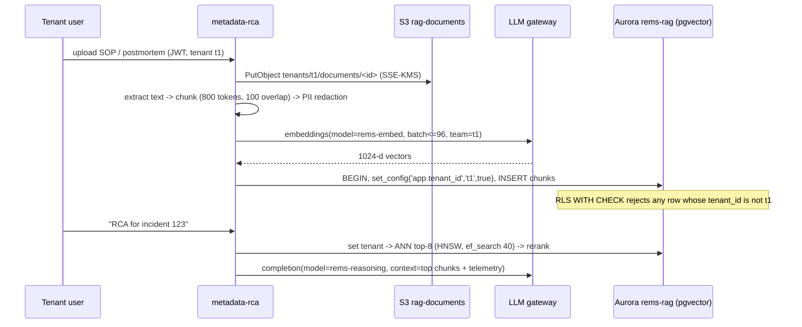

# RAG Pipeline (Metadata RCA / Savvy)

## Design decisions

| Topic | Decision | Why |
|---|---|---|
| Vector store | pgvector on a **dedicated** Aurora cluster | Same operational model as the rest of the data (backups, PITR, Global DB, RLS). OpenSearch Serverless was rejected: higher minimum cost, and a second isolation model to secure |
| Index | HNSW `m=16, ef_construction=64`. `ef_search` 40 (raise to 100 for recall-critical queries) | No retraining, good recall at < 20 ms for < 10 M vectors per cluster |
| Tenant isolation | `tenant_id` column + RLS on every table. Partial HNSW indexes per very large tenant (`WHERE tenant_id = …`) | Prevents cross-tenant retrieval even if the app forgets the filter |
| Embedding model | Titan Text Embeddings v2 (1024-d) through the gateway. The `model` column stores the version | Re-embedding is a background job on the `workers` pool when the model changes |
| Chunking | 800 tokens / 100 overlap, Markdown-aware for SOPs | Balances recall and context cost |
| Data protection | PII redaction before embedding. Raw documents stay in S3 (tenant prefix, KMS). Vectors are never sent to external providers | Embeddings can leak content, so they're treated as tenant data |
| Scaling | Readers auto scale 1→3. Batch ingestion uses the writer through RDS Proxy with ≤ 4 concurrent writers per tenant | Ingest bursts must not starve retrieval |
| Cost | Embedding backfills run off-peak (Spot workers), with content-hash dedup (`UNIQUE (tenant_id, sha256)`) | Avoids paying to re-embed identical documents |
| Retention | Documents follow the tenant contract. Deleting a document cascades to its chunks. S3 noncurrent versions expire after 90 d | Supports "right to be forgotten" |

## Evaluation and operations

* Offline retrieval eval per release: recall@8 on a labelled set of past incidents and their correct SOPs (gate ≥ 0.8).
* Metrics: retrieval latency p95, chunks per tenant, embedding tokens per tenant (gateway), and RCA acceptance rate (product metric).
* Reindex procedure: `REINDEX INDEX CONCURRENTLY savvy.chunks_embedding_hnsw` during a low-traffic window on the writer. Readers keep serving.
