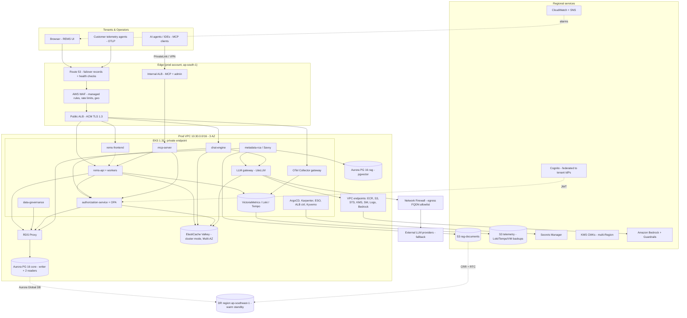

# 01 – Complete AWS Architecture (Production)

## Component placement summary

| Layer | Service | Placement | Why |
|---|---|---|---|
| Edge | Route 53, WAF, ALB (via AWS Load Balancer Controller) | Public subnets, 3 AZ | Managed L7, WAF integration, TLS offload |
| Compute | EKS managed control plane + Karpenter-provisioned nodes | private-app subnets, 3 AZ | Independent per-service scaling, bin-packing, Spot |
| Data | Aurora PostgreSQL (core + rag), ElastiCache Valkey, RDS Proxy | private-data subnets, no route to the internet | Isolation, managed HA |
| Storage | S3 (documents, telemetry, artifacts, logs) | Regional, reached via gateway endpoint | 11 nines durability, lifecycle tiering |
| AI | Bedrock (interface endpoint), LLM gateway in EKS, external providers via Network Firewall | private | Quota control, data protection, failover |
| Security | GuardDuty, Security Hub, CloudTrail (org), Config, Inspector, Access Analyzer | Security + Log Archive accounts | Central, tamper-resistant |
| Observability | OTel Collector, kube-prometheus-stack, Loki, Tempo, Grafana, CloudWatch | EKS `observability` node pool + CloudWatch | Self-monitoring with an out-of-band path |

See the other documents in this folder for each layer in detail.
