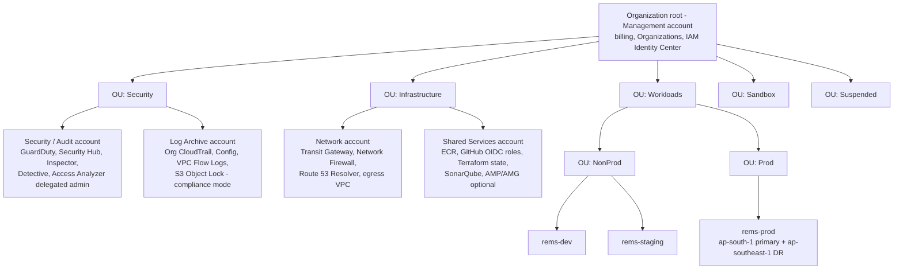

# 02 – Multi-Account Landing Zone

Implemented in `terraform/landing-zone/` (AWS Organizations + SCPs). It's compatible with Control Tower: if CT is already in use, keep the OU/SCP files and drop the account resources.

## Guardrails (Service Control Policies)

| SCP | Attached to | Effect |
|---|---|---|
| `deny-leave-org-and-disable-security` | Root (except mgmt) | Blocks leaving the org, disabling CloudTrail/GuardDuty/Security Hub/Config, and deleting flow logs |
| `region-restriction` | Workloads, Infrastructure | Only ap-south-1, ap-southeast-1 (+ us-east-1 for global services) |
| `deny-root-user` | All OUs | Root user actions denied |
| `protect-security-roles` | All OUs | Nobody except the break-glass/pipeline roles can modify `OrganizationAccountAccessRole`, `rems-*-pipeline`, or permission boundaries |
| `require-imdsv2-and-encryption` | Workloads | Denies EC2 launch without IMDSv2, unencrypted EBS/RDS/S3 objects without SSE-KMS |
| `deny-iam-users-and-keys` | Workloads | No long-lived IAM users or access keys. Humans use Identity Center, CI uses GitHub OIDC |
| `prod-change-protection` | Prod OU | Denies `eks:DeleteCluster`, `rds:DeleteDBCluster`, `kms:ScheduleKeyDeletion`, and `s3:DeleteBucket` unless the principal carries the `break-glass` tag |

## Access model

* **Humans** – IAM Identity Center permission sets (`ReadOnly`, `Developer` in non-prod, `PlatformAdmin`, `BreakGlass` with MFA + alerting). They're mapped to EKS access entries, so there's no `aws-auth` ConfigMap.
* **CI/CD** – GitHub OIDC → `rems-<env>-github-terraform` / `rems-github-ecr-push` roles, scoped by repo, branch and environment via the `token.actions.githubusercontent.com:sub` condition.
* **Workloads** – EKS Pod Identity. One IAM role per service, each with a permission boundary.
* **Cross-account** – Prod and staging pull images from the Shared Services ECR through a repository policy that grants `ecr:BatchGetImage` to the workload account node roles.
