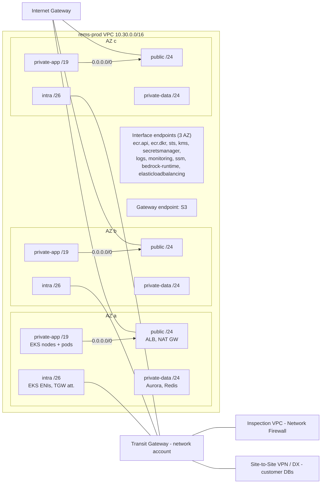

# 03 – Multi-AZ VPC & Network Architecture

## CIDR plan

| Env | Region | VPC CIDR | private-app (per AZ) | private-data | public | intra |
|---|---|---|---|---|---|---|
| dev | ap-south-1 | 10.10.0.0/16 | /19 ×3 | /24 ×3 | /24 ×3 | /26 ×3 |
| staging | ap-south-1 | 10.20.0.0/16 | /19 ×3 | /24 ×3 | /24 ×3 | /26 ×3 |
| prod | ap-south-1 | 10.30.0.0/16 | /19 ×3 | /24 ×3 | /24 ×3 | /26 ×3 |
| prod-dr | ap-southeast-1 | 10.40.0.0/16 | /19 ×3 | /24 ×3 | /24 ×3 | /26 ×3 |

The /19 app subnets (8 187 IPs each) with **VPC CNI prefix delegation** support more than 110 pods per node and well over 1 000 nodes per AZ, so no secondary CIDR is needed.

## Segmentation and controls

| Control | Implementation |
|---|---|
| No public compute | Nodes only run in private-app subnets. EKS API endpoint is private, with an optional public endpoint restricted to CIDRs in dev |
| Data tier isolation | private-data subnets have **no default route**. SGs only accept 5432 from the RDS Proxy SG / EKS node SG, and 6379 from the EKS node SG |
| NAT per AZ | No cross-AZ dependency for egress (static stability during an AZ failure). Dev uses a single NAT to save cost |
| Egress filtering | Prod egress can route through the Network Firewall inspection VPC (FQDN allowlist: LLM providers, GitHub, OS mirrors) |
| PrivateLink | AWS APIs over interface endpoints keep the traffic off the NAT. This is cheaper and keeps credentials-bearing calls private |
| Pod-level | Kubernetes NetworkPolicies (VPC CNI network policy agent): default-deny per namespace plus explicit allows |
| SG for Pods | Optional for the Data Governance scanner pods that need per-tenant DB reachability |
| Flow logs | VPC flow logs go to the Log Archive S3 bucket (parquet, 90-day retention) |
| DNS | Route 53 private hosted zone `rems.internal`, Resolver DNS Firewall blocks known-bad domains |
