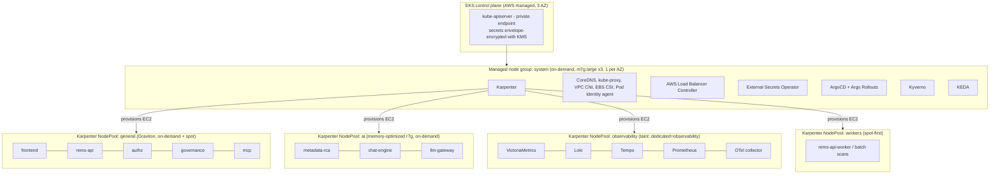
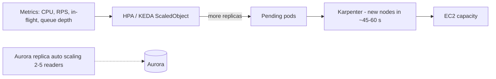

# 04 – EKS Platform Architecture

## Compute provisioning

| Mechanism | Role |
|---|---|
| **Managed node group `system`** | Hosts controllers only. Tainted `CriticalAddonsOnly`. Fixed size of 3 (one per AZ) so Karpenter never schedules itself |
| **Karpenter 1.x** | Provisions right-sized nodes in seconds from pending pods. Consolidation (`WhenEmptyOrUnderutilized`) bin-packs. Disruption budgets limit voluntary churn (`10%`, none during business hours in prod for the `ai` pool) |
| **Spot** | `workers` and part of `general` in non-prod use Spot with a diversified instance set (c/m/r 7g/6g, 8 families). Karpenter's interruption queue (SQS + EventBridge) drains nodes ahead of the 2-minute reclaim |
| **Graviton** | Multi-arch images. `kubernetes.io/arch` requirement prefers arm64 |

## Pod scheduling

* `topologySpreadConstraints` on `topology.kubernetes.io/zone` (maxSkew 1) and `kubernetes.io/hostname` for every service. Zone spread uses `ScheduleAnyway`, so a lost AZ never blocks rescheduling.
* `PriorityClass`: `rems-critical` (authz, api), `rems-high` (chat, rca, mcp, frontend), `rems-batch` (workers, scans – preemptible).
* Requests are set from load-test p95 usage. CPU limits are only set where noisy-neighbour risk exists, and memory limit equals the request (Guaranteed memory).
* Node pools are isolated by taints and tolerations (observability, ai).

## Autoscaling layers

* **HPA v2** on CPU (60–70 %) with fast scale-up (`+100 %` or `+4 pods` every 15 s) and slow scale-down (5-min stabilisation).
* **KEDA** for event-driven services: Prometheus `rate(http_server_request_duration_seconds_count)` per pod for the API, in-flight requests for chat/RCA, and Redis list length for workers.
* **Over-provisioning:** a `pause` deployment at `rems-overprovision` priority (-10) holds about 10 % headroom so a 10× spike lands on warm nodes while Karpenter adds more.

## Ingress, service discovery, zero downtime

* **Ingress:** AWS Load Balancer Controller with an `IngressGroup` `rems-public` (one ALB per environment), `target-type: ip` (no NodePort hop), WAF ACL annotation, ACM certificate, TLS 1.3 policy. A separate internal ALB serves MCP and admin.
* **Service discovery:** CoreDNS (`<svc>.<ns>.svc.cluster.local`). Pods connect to Aurora via the RDS Proxy endpoint and to Redis via its configuration endpoint, both published as Route 53 private records.
* **Zero-downtime:** Argo Rollouts canary (10 % → 25 % → 50 % → 100 %) with ALB weighted target groups and Prometheus analysis. Readiness gates (`elbv2.k8s.aws/pod-readiness-gate-inject`) make sure ALB health passes before old pods leave. `preStop` sleep of 15 s handles ALB deregistration. PDBs and `maxUnavailable: 0`.
* **Cluster upgrades:** blue/green node pools via Karpenter drift (AMI and K8s version bump). The control plane is upgraded in staging first, with a 1-week soak.
