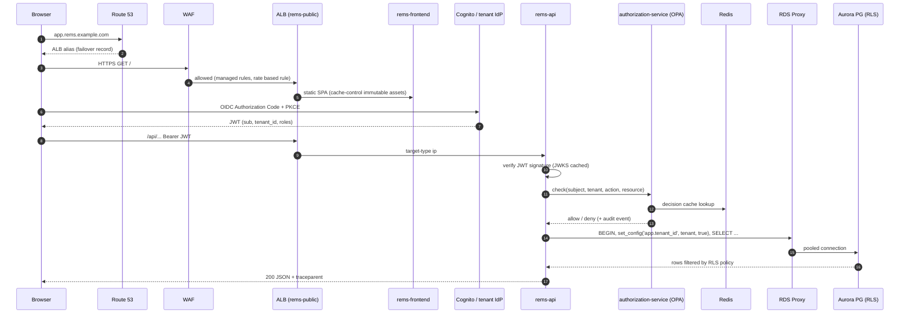
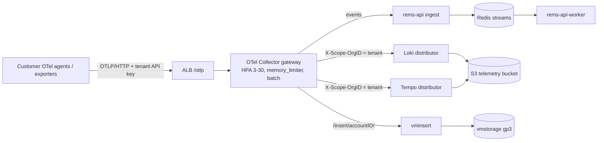
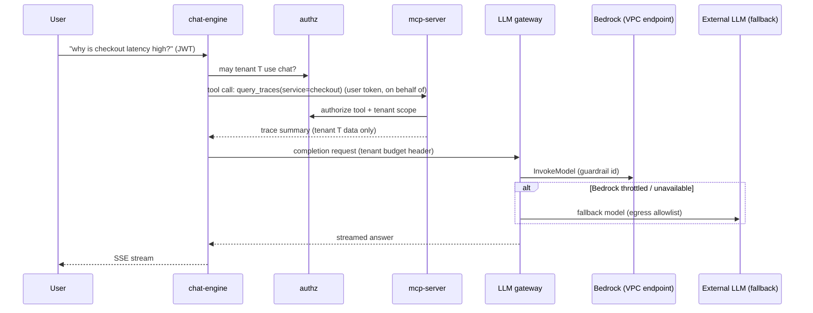

# 05 – Application Traffic Flow

## User request (UI → API → data)

## Telemetry ingestion (50 M events/day)

## AI / chat flow

## East-west allow-list (enforced by NetworkPolicies)

| From → To | Port | Why |
|---|---|---|
| ingress (ALB IPs) → frontend, rems-api, chat-engine, otel-gateway | app ports | Public entry |
| internal ALB → mcp-server | app port | MCP clients |
| frontend → none | – | SPA only |
| rems-api → authz, Redis, RDS Proxy, VictoriaMetrics, Loki, Tempo, kube-apiserver | various | PDF integrations |
| chat-engine → authz, mcp-server, llm-gateway, Redis, rems-api | | |
| metadata-rca → authz, llm-gateway, RDS Proxy (rag), S3 (endpoint) | | |
| mcp-server → authz, rems-api, VictoriaMetrics, Loki, Tempo (read paths only) | | |
| data-governance → authz, RDS Proxy, customer DB CIDRs (TGW) | 5432/3306 | DB scanning |
| llm-gateway → Bedrock endpoint, Network Firewall egress | 443 | LLMs |
| all → kube-dns 53, otel-collector 4317/4318 | | DNS, telemetry |
