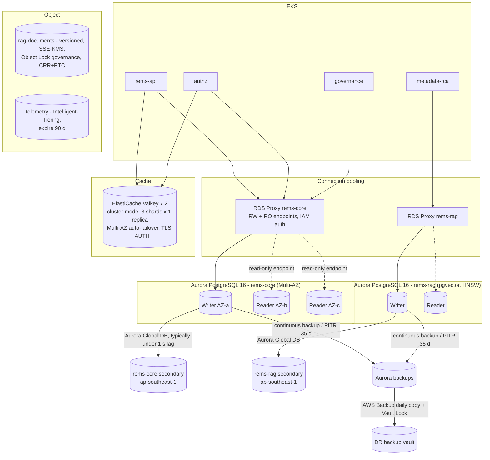

# 06 – Database & Data Architecture

## Decisions

| Concern | Decision | Notes |
|---|---|---|
| Engine | Aurora PostgreSQL 16.x | pgvector ≥ 0.7 supported. Storage is replicated six ways across 3 AZs. Failover takes under 30 s |
| Workload split | `rems-core` (API, authz, governance) and `rems-rag` (Savvy vectors and documents metadata) are separate clusters | Vector index builds and similarity search are CPU/IO heavy and mustn't starve OLTP. Each scales on its own |
| Logical DBs | `rems_api`, `rems_authz`, `rems_governance` on core. `rems_savvy` on rag | One DB owner role per service. Least privilege via `database/sql/01-roles.sql` |
| Pooling | RDS Proxy (pinning-aware) plus small app-side pools (≤ 10 per pod) | Proxy multiplexes thousands of client connections onto ~ 60 % of `max_connections`, and makes failover transparent (about 66 % faster) |
| Read scaling | Aurora replica auto scaling 2→5 on `RDSReaderAverageCPUUtilization` 60 % | API read paths use the `-ro` proxy endpoint |
| Encryption | KMS CMK (multi-Region) at rest. TLS enforced (`rds.force_ssl=1`). IAM DB auth for services | |
| Tenant isolation | `tenant_id` column + Row-Level Security policies keyed on `current_setting('app.tenant_id')`. Silo tenants get a dedicated cluster | `database/sql/03-row-level-security.sql` |
| Backups | Continuous backups with 35-day PITR (RPO ≈ 5 min), plus daily AWS Backup copies to the DR region vault (Vault Lock, 35 d), plus monthly snapshots kept for 1 year | |
| Replication / DR | Aurora Global Database (storage-level, typical lag < 1 s). Managed switchover for planned events, `failover-global-cluster --allow-data-loss` for regional loss | RPO ≪ 15 min |
| Restore | Scripted PITR restore to a new cluster, validated monthly in staging (`database/scripts/restore-pitr.sh`) | |
| Monitoring | Performance Insights (7 d free tier, 2 y prod), Enhanced Monitoring 15 s, `postgres_exporter` sidecar-less via CloudWatch metrics, slow-query log to CloudWatch | |
| Redis | Valkey 7.2 cluster mode, 3 shards × 1 replica (prod), Multi-AZ, encryption in transit and at rest, AUTH token from Secrets Manager, daily snapshot with 7-day retention | Cache, rate limits, sessions and queues. Rebuildable |
| Object storage | S3 with Bucket Keys, versioning, Block Public Access, TLS-only policy, lifecycle (IA at 30 d, Glacier IR at 90 d for documents, expiry at 90 d for telemetry) | |

## Observability data services (product data)

| Store | Mode | Retention | Storage |
|---|---|---|---|
| VictoriaMetrics cluster | vminsert ×3, vmselect ×3, vmstorage ×3 (replicationFactor 2) | 90 d (`-retentionPeriod=90d`) | gp3 EBS, vmbackup to S3 daily |
| Loki (SimpleScalable / distributed) | multi-tenant (`auth_enabled: true`) | per-tenant 30–90 d via `limits_config.retention_period` and overrides | S3 (TSDB index + chunks) |
| Tempo (distributed) | multi-tenant, metrics-generator for service graphs | 30 d | S3 |
