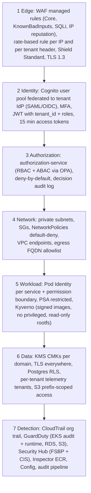
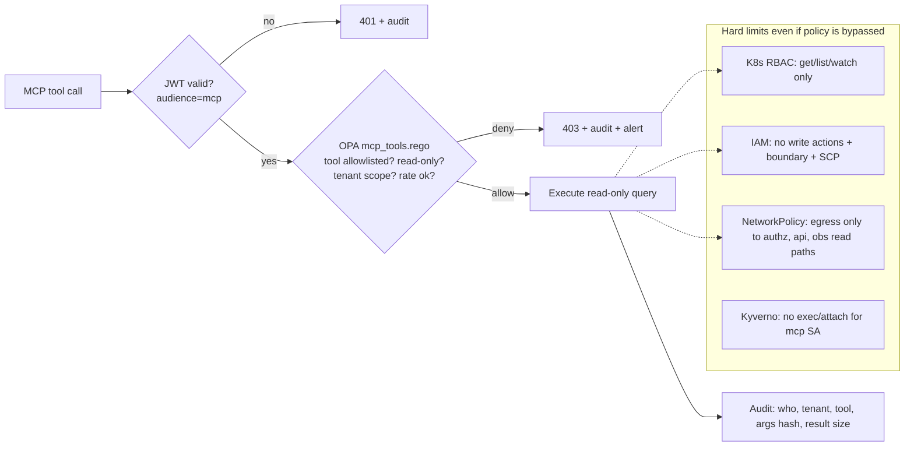

# 07 – Security Architecture

## Defence in depth

## Identity

| Principal | Mechanism | Scope |
|---|---|---|
| End users | Cognito (one user pool, one app client per env). Federation to the customer IdP per tenant. `custom:tenant_id` claim injected by a pre-token-generation Lambda from the IdP mapping | Per tenant |
| Service-to-service | Short-lived JWT from the calling user (on-behalf-of) plus K8s NetworkPolicy. Optional mesh mTLS (VPC Lattice / Istio ambient) noted as phase 2 | Per call |
| Workloads → AWS | EKS Pod Identity → IAM role per service, with permission boundary `rems-workload-boundary` | Least privilege |
| CI/CD → AWS | GitHub OIDC (`sts:AssumeRoleWithWebIdentity`) bound to `repo:<org>/<repo>:environment:<env>` | Per env |
| Operators → AWS/EKS | IAM Identity Center → EKS access entries (`AmazonEKSClusterAdminPolicy` only for break-glass, `AmazonEKSViewPolicy` for read) | MFA, session ≤ 1 h |

## Tenant isolation – five independent layers

| Layer | Control | What it stops |
|---|---|---|
| L1 Token | `tenant_id` comes from a signed JWT. It's never taken from a request body or URL | Spoofed tenant parameter |
| L2 Authz | OPA policy `security/opa/tenant_isolation.rego`: `input.resource.tenant_id == input.subject.tenant_id`, otherwise deny, and every decision is logged | Broken object-level authorization (BOLA/IDOR) |
| L3 Database | Postgres RLS `USING (tenant_id = current_setting('app.tenant_id')::uuid)` with `FORCE ROW LEVEL SECURITY`. The app role is not the table owner and has no `BYPASSRLS` | App bug forgetting a WHERE clause |
| L4 Telemetry | Loki/Tempo `X-Scope-OrgID`, VictoriaMetrics `accountID`, set only by the gateway/API from the token | Cross-tenant log and trace reads |
| L5 Objects / AI | S3 keys `tenants/<tenant_id>/…`. RAG retrieval filters on `tenant_id` before vector search (RLS also applies). LLM prompt context is built only from authorized rows | Cross-tenant RAG leakage |

Silo option: a tenant marked `isolation: dedicated` gets its own Aurora cluster, KMS key and namespace (`tenant-<id>`) through the same Terraform modules and Helm values.

## Encryption & secrets

* KMS CMKs (rotation on). Dedicated DR-region keys for Aurora, secrets, S3 and backup are created by the prod stack: `eks-secrets`, `aurora`, `elasticache`, `s3-documents`, `s3-telemetry`, `secrets-manager`, `logs`, `backup`.
* Secrets Manager holds DB credentials (managed rotation every 30 days), Redis AUTH, LLM provider API keys and per-tenant DB scanning credentials. Secrets are replicated to the DR region.
* External Secrets Operator syncs Secrets Manager into K8s Secrets (refresh 1 h). K8s Secrets are envelope-encrypted with the `eks-secrets` key.
* Nothing is hardcoded in Git. CI uses OIDC, with no static keys.

## Supply chain

`Trivy fs` → `SonarQube quality gate` → build → `Trivy image` (fail on HIGH/CRITICAL with a fix available) → SBOM (Syft, SPDX) → `cosign sign` (keyless, GitHub OIDC) → ECR (immutable tags, scan on push with Inspector enhanced) → Kyverno `verifyImages` admits only signed images from the REMS ECR.

## MCP security (compromised tool scenario)

Audit events from authz and MCP flow as structured JSON to stdout → OTel/Fluent Bit → CloudWatch Logs `/rems/<env>/audit` (KMS, 1-year retention) → subscription → Log Archive S3 with Object Lock. GuardDuty EKS audit-log monitoring plus a CloudWatch metric filter alerts on `decision="deny" AND component="mcp"` bursts.
