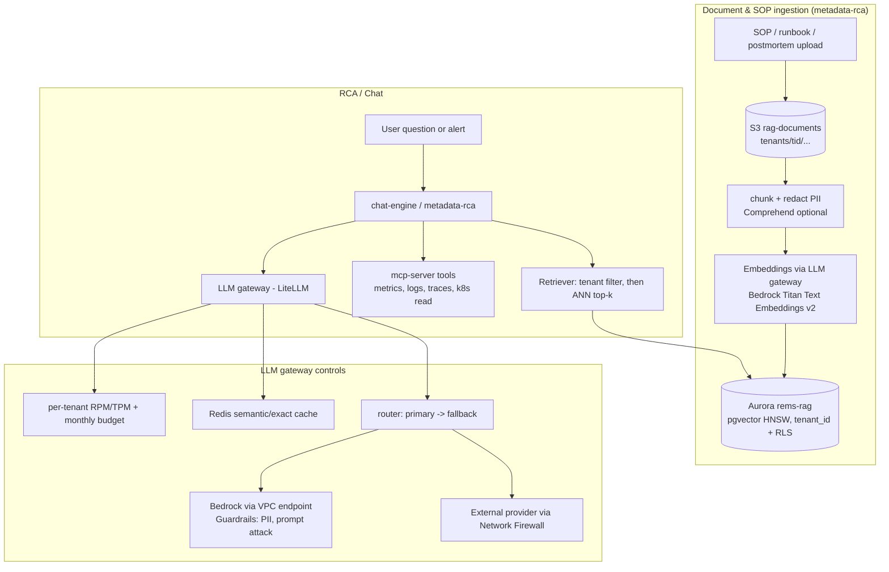

# 08 – AI / RAG / MCP Architecture

## Scaling & concurrency

| Component | Bound by | Scaling signal | Limits |
|---|---|---|---|
| chat-engine | LLM latency (I/O) | KEDA: in-flight requests per pod > 20 | min 3 / max 20 (prod). SSE idle timeout 300 s |
| metadata-rca | LLM + vector search | KEDA: in-flight RCA jobs, CPU | min 2 / max 12 |
| llm-gateway | provider quotas | CPU 60 % | min 3 / max 12 |
| Embeddings | Bedrock TPM quota | batch size 96, worker concurrency = quota ÷ avg tokens | backfill jobs on `workers` pool (Spot) |
| pgvector | Aurora rag CPU/IO | reader auto scaling | HNSW `m=16, ef_construction=64`, `ef_search=40`, partial indexes for large tenants |

**Provider quotas.** Bedrock on-demand TPM/RPM per model is a Service Quota, monitored in CloudWatch (`AWS/Bedrock` `InvocationThrottles`). Increases are requested ahead of tenant onboarding. Provisioned Throughput is only bought when steady usage exceeds about 60 % of on-demand quota. The gateway enforces per-tenant quotas so no single tenant can exhaust the shared provider quota.

**Provider outage / rate limiting.** Gateway retries with exponential backoff and jitter (max 2), then falls back to the next model in the chain (Bedrock Claude → Bedrock Llama/Mistral → external provider), with a circuit breaker (open after 5 failures in 30 s, half-open after 60 s). Chat degrades gracefully: it returns tool results and deterministic RCA heuristics without an LLM summary. RCA jobs queue in Redis and resume later.

## Data protection

* Bedrock: in-region, PrivateLink, no data used for training, model invocation logging to the encrypted S3/CloudWatch audit bucket (prompts are redacted by guardrails first).
* PII redaction before embedding and before prompts (Guardrails sensitive-information filters). The tenant setting `allow_external_llm: false` pins a tenant to Bedrock only.
* Prompt-injection defence: tool outputs are treated as data, there's a system prompt boundary, and Guardrails prompt-attack filter is on. MCP tools are read-only and authorized per call.

## Cost controls

* Per-tenant monthly budget in the gateway (hard stop at 100 %, alert at 80 %), and per-request `max_tokens` caps.
* Model tiering: a small model for classification and summarization, and a large model only for final RCA.
* Exact-match plus semantic cache in Redis (TTL 1 h) for repeated alert explanations.
* Batch embeddings off-peak on Spot.
* CloudWatch dashboard plus a Cost Anomaly Detection monitor on `Amazon Bedrock`.

## MCP server

* Streamable HTTP transport behind an **internal** ALB, reached through VPN/PrivateLink. It's never public by default.
* OAuth 2.1 bearer tokens (Cognito, audience `mcp`) with the `tenant_id` claim.
* Each tool is declared in `security/opa/mcp_tools.rego` with `{read_only: true, max_rows, allowed_roles}`. Unknown tools are denied.
* Its K8s ServiceAccount has a read-only ClusterRole (no secrets). The IAM role has no write actions, and SCP blocks mutating calls anyway.
* Full audit trail per call (see `architecture/07-security.md`).
