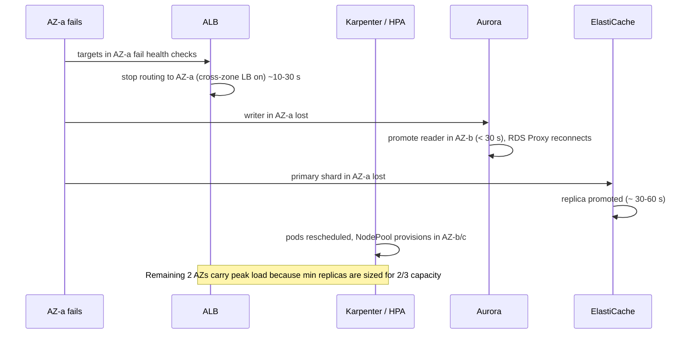

# 09 – High Availability & Disaster Recovery

Targets from the PDF: **99.95 % availability** (≤ 21.9 min downtime/month), **automatic recovery from a single-AZ failure**, **RPO 15 min / RTO 2 h** for critical services.

## Availability budget (serial dependencies on the critical path)

| Component | AWS SLA / design | Notes |
|---|---|---|
| ALB | 99.99 % | |
| EKS control plane | 99.95 % | Data plane keeps serving if the API server is down |
| Pods (3 AZ, N+1) | ≥ 99.99 % (design) | PDB, topology spread, readiness gates |
| Aurora Multi-AZ | 99.99 % | Failover < 30 s, masked by RDS Proxy |
| ElastiCache Multi-AZ | 99.99 % | Cache-aside, so the app survives a Redis loss |
| Composite ≈ 99.99 × 99.95 × 99.99 × 99.99 × 99.99 ≈ **99.91 %** worst case if every SLA is hit simultaneously. In practice the EKS API isn't on the request path, which gives **≈ 99.96 %** | | Meets 99.95 % |

## Single-AZ failure (automatic)

Static stability: NAT gateway per AZ, endpoints in every AZ, replicas sized for N+1 AZs, no control-plane calls needed to keep serving.

## Regional DR – warm standby

| Tier | Component | DR mechanism | RPO | RTO |
|---|---|---|---|---|
| Critical | Aurora rems-core / rems-rag | Aurora Global Database secondary in ap-southeast-1 (1 instance per cluster on standby, scaled out by `dr_promoted=true`) | < 1 s typical (alarm if lag > 60 s) | ~ 5 min (managed failover) |
| Critical | S3 rag-documents | CRR with Replication Time Control | 15 min (99.99 % SLA) | 0 |
| Critical | Secrets | Secrets Manager replica secrets | 0 | 0 |
| Critical | KMS | Dedicated keys in the DR region (created by the primary stack, used by replicas) | 0 | 0 |
| Critical | Images | ECR cross-region replication | minutes | 0 |
| Critical | EKS apps | DR EKS cluster always running (system nodes + 1 replica per service), synced by ArgoCD from the same Git | 0 (stateless) | 20–40 min scale-up |
| Important | Redis | Cold rebuild in DR (cache) | n/a | 10 min |
| Important | Telemetry (Loki/Tempo/VM) | New ingestion starts in DR immediately. History replicated for S3 objects only (optional CRR without RTC) | 24 h | ingestion 30 min |
| Infra | Terraform | `environments/prod-dr` state, same modules | – | – |

**RTO budget (2 h):** detect and declare (15 min) → promote Aurora global secondary (10 min) → scale DR EKS by setting `replicaProfile=prod` in GitOps (30 min) → smoke tests (15 min) → Route 53 failover / DNS TTL 60 s (5 min) = **~75 min**, which leaves a 45-min buffer. Procedure: `runbooks/dr-regional-failover.md`.

## Recovery validation

| Test | Frequency | Tooling |
|---|---|---|
| AZ power interruption | Quarterly in staging, yearly in prod (game day) | AWS FIS `aws:network:disrupt-connectivity` + `aws:rds:failover-db-cluster` + `aws:elasticache:replicationgroup-interrupt-az-power` |
| Aurora PITR restore | Monthly | `database/scripts/restore-pitr.sh` + data checksums |
| Regional failover | Twice a year (planned switchover) | `aws rds switchover-global-cluster` |
| Backup restore (AWS Backup) | Quarterly | AWS Backup restore testing plan |
| Pod/node chaos | Each release in staging | k6 + `kubectl drain` + FIS `aws:eks:pod-delete` |
