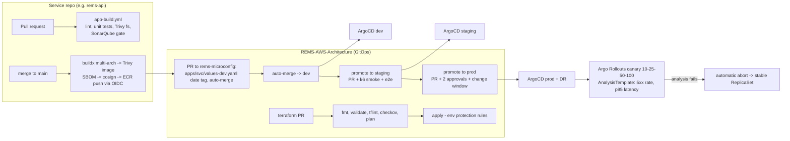

# 10 – CI/CD & GitOps Architecture

## Stages and gates

| Stage | Gate | Fails the build when |
|---|---|---|
| PR | Unit tests, lint, `trivy fs` (secrets, IaC, vulns), SonarQube quality gate | coverage < 80 % on new code, any secret, HIGH/CRITICAL vuln with fix |
| Build | `trivy image`, SBOM, cosign signature | HIGH/CRITICAL fixable vulns |
| Dev | ArgoCD auto-sync, smoke tests | health degraded > 5 min |
| Staging | k6 `normal-load` + `peak-5x` smoke, OWASP ZAP baseline (optional) | p95 > SLO, error rate > 1 % |
| Prod | GitHub Environment `production` (2 reviewers, `main` only, wait timer), canary analysis | AnalysisRun failure → auto-rollback |
| Terraform | `fmt`, `validate`, `tflint`, `checkov`, plan posted to PR, manual approval for staging/prod apply | any HIGH checkov finding not suppressed with justification |

## Rollback paths

1. **Automatic (canary):** Argo Rollouts aborts and scales the canary to 0. Stable keeps 100 % of traffic. Time to recover is under 1 min.
2. **Post-promotion regression:** `kubectl argo rollouts undo <svc> -n rems` or `git revert` of the promotion commit. ArgoCD syncs in under 3 min.
3. **Helm-level:** `argocd app rollback rems-prod-<svc> <history-id>` (sync window permitting).
4. **Database:** expand/contract migrations only. Destructive migrations ship one release after code stops using the column, so app rollback never needs a DB rollback.
5. **Terraform:** revert the PR and apply. State versioning in S3 allows recovery.
