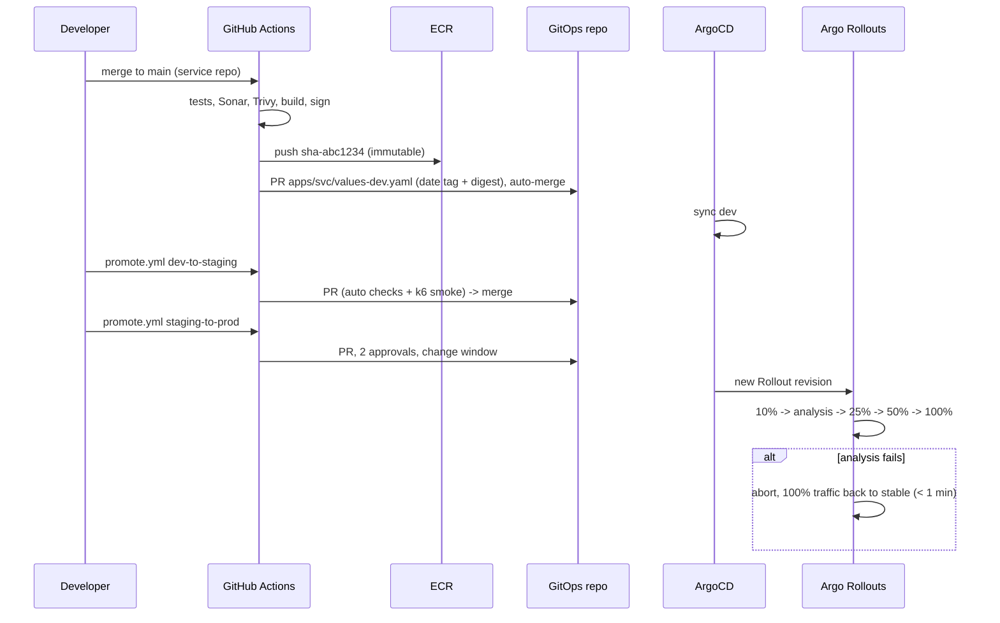

# CI/CD and GitOps

GitHub Actions workflows live in [`/.github/workflows`](../.github/workflows), because GitHub only runs them from there.
Promotion, rollback and validation workflows live in the common **rems-microconfig** repo (template: [`microconfig-repo-template/`](microconfig-repo-template/)),
which is created and protected by [`terraform/cicd/github`](../terraform/cicd/github). ArgoCD itself is installed and wired to that repo by
[`terraform/cicd/argocd`](../terraform/cicd/argocd).
This folder holds the GitOps side: ArgoCD, Argo Rollouts and pipeline docs.

| Workflow | Trigger | What it does |
|---|---|---|
| `app-build.yml` (reusable) | Service repos on PR/push | PR: tests → SonarQube gate → Trivy fs. Merge: **date tag `YYYY.MM.DD-<run>`** → lint (hadolint, yamllint) → build → **Trivy image gate before push** → multi-arch push to ECR (OIDC) → SBOM → cosign → GitHub release → **auto-merge PR to `rems-microconfig`** (`apps/<svc>/values-dev.yaml`) |
| `promote.yml` (**in rems-microconfig**) | Manual | Copies the immutable tag + digest dev→staging or staging→prod in a PR (CODEOWNERS; prod needs 2 distinct approvals, enforced by `validate`) |
| `rollback.yml` (**in rems-microconfig**) | Manual | Opens a `rollback`-labelled PR restoring the previous image tag (audited) |
| `validate.yml` (**in rems-microconfig**) | Every PR / review | Required check: YAML, tag/digest format, no `:latest`, prod tag must equal staging, two-person rule for prod |
| `terraform.yml` | PR / push on `terraform/**` | fmt, validate, tflint, Checkov, plan per env (read-only role, posted to PR) → ordered apply dev → staging → prod → prod-dr behind GitHub Environments |
| `k8s-validate.yml` | PR on charts/manifests | helm lint/template + kubeconform (7 charts × 3 envs), kustomize builds, OPA tests, yamllint, Checkov |
| `security-scan.yml` | Nightly | Gitleaks, Trivy config, re-scan of the images running in prod |
| `load-test.yml` | Manual / weekly | k6 scenarios against staging |

## GitHub configuration (one-time)

| Setting | Value |
|---|---|
| Environments | `dev` (no reviewers), `staging` (1 reviewer), `prod` and `prod-dr` (2 reviewers, `main` only, 10-minute wait timer), `promote-staging`, `promote-prod`, `rollback-*`, `plan-*`, `load-test-staging` |
| Environment variables | `AWS_ROLE_PLAN`, `AWS_ROLE_APPLY` (per env, from `terraform/global/bootstrap` outputs) |
| Org variables | `AWS_ECR_PUSH_ROLE`, `AWS_ECR_PULL_ROLE`, `ECR_REGISTRY`, `SONAR_HOST_URL` |
| Org secrets | `SONAR_TOKEN`, `K6_TEST_USER_TOKEN`. `CONFIG_APP_ID` / `CONFIG_APP_PRIVATE_KEY` (GitHub App scoped to rems-microconfig) are set per service repo by `terraform/cicd/github` |
| Branch protection on `main` | Required checks (`terraform / static`, `k8s-validate / *`), CODEOWNERS review, signed commits, linear history |

No AWS access keys exist anywhere. Every AWS call uses GitHub OIDC → `sts:AssumeRoleWithWebIdentity`, and the trust
policies are pinned to `repo:<org>/<repo>:environment:<env>` or `ref:refs/heads/main`.

## ArgoCD layout

```
cicd/argocd/
  install/values.yaml          HA ArgoCD, SSO (Identity Center), RBAC, Rollout health check, Slack notifications
  projects/projects.yaml       AppProjects: platform (add-ons) and rems (apps: rems + rems-ai namespaces only, prod sync windows)
  bootstrap/root-<env>.yaml    app-of-apps entry point per cluster
  apps/<env>/platform-addons.yaml   ApplicationSet: Karpenter, ALB controller, ESO, KEDA, Rollouts, Kyverno, metrics-server,
                                    external-dns, kube-prometheus-stack, VictoriaMetrics, Loki, Tempo, OTel, LLM gateway
  apps/<env>/rems-services.yaml     ApplicationSet: the 7 REMS charts (sync waves: authz → api/governance/rca → mcp/chat → frontend)
cicd/argo-rollouts/analysis-templates.yaml   5xx ratio, p95 latency and pod-restart canary checks
```

## Deployment flow and rollback


