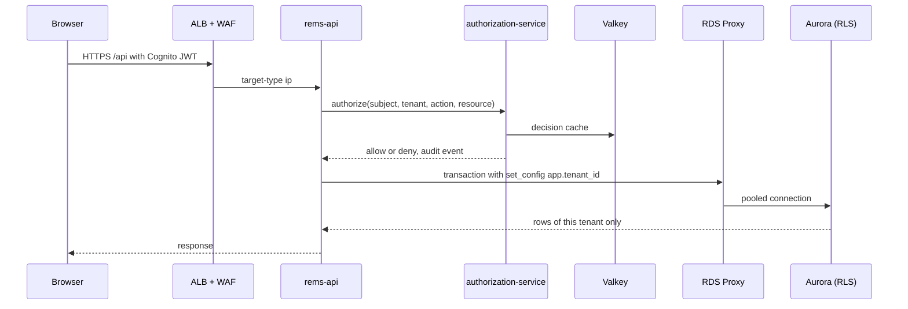

# Application Architecture

**Status:** 🟡 Helm charts implemented and render-validated for all 7 services. Application-specific values (ports, health paths, env var names, API routes) are **placeholders**, because the service source repositories were not available (`documentation/02-assumptions.md`, P1–P9).

## Service matrix (values from `helm/charts/*/values.yaml` and `values-prod.yaml`)

| Service | Namespace | Exposure | Node pool | Priority | Autoscaling (prod min–max) | Delivery (staging/prod) |
|---|---|---|---|---|---|---|
| rems-frontend | rems | public ALB `/` | general | rems-high | HPA CPU 70 % (3–10) | Argo Rollout canary |
| rems-api | rems | public ALB `/api` | general | rems-critical | KEDA RPS + CPU (6–40) | Argo Rollout canary |
| authorization-service | rems | ClusterIP | general | rems-critical | HPA CPU 60 % (3–20) | Argo Rollout canary |
| data-governance | rems | ClusterIP | general | rems-high | HPA CPU 70 % (2–10) | Argo Rollout canary |
| metadata-rca | rems-ai | ClusterIP | ai | rems-high | KEDA in-flight + CPU (2–12) | Argo Rollout canary |
| chat-engine | rems-ai | public ALB `/chat` (idle timeout 300 s) | ai | rems-high | KEDA in-flight + CPU (3–20) | Argo Rollout canary |
| mcp-server | rems-ai | **internal** ALB `/mcp` | general | rems-high | HPA CPU 60 % (2–10) | Argo Rollout canary |
| llm-gateway (LiteLLM) | rems-ai | ClusterIP :4000 | ai | – | HPA CPU 60 % (3–12) | Helm (third-party chart) |

The path prefixes (`/api`, `/chat`, `/mcp`) are routing assumptions that the assumptions file doesn't list yet. Container ports `8000` / `8080` are placeholders (P1/P2).

## Communication flow

## East-west allow-list (enforced by the chart NetworkPolicies)

Each chart's `networkPolicy.ingressFrom`, `egressTo` and `egressCIDRs` values render into a NetworkPolicy (`rems-common.networkPolicy`). For example, `helm/charts/chat-engine/values.yaml` allows egress only to authorization-service, rems-api, mcp-server, metadata-rca, llm-gateway (4000) and Valkey (6379).

| From | To |
|---|---|
| ALB (VPC CIDR) | frontend, rems-api, chat-engine; mcp-server (internal ALB) |
| rems-api | authz, governance, metadata-rca, observability read/write ports, Aurora/Valkey (data subnets), kube-apiserver (read-only RBAC) |
| chat-engine | authz, rems-api, mcp-server, metadata-rca, llm-gateway, Valkey |
| metadata-rca | authz, llm-gateway, Aurora rag, Valkey, S3 (443) |
| mcp-server | authz, rems-api, observability read ports, kube-apiserver |
| data-governance | authz, Aurora core, VPC endpoints, customer DB CIDRs (placeholder `172.31.0.0/16`) |
| llm-gateway | Aurora (spend DB), Valkey, Bedrock endpoint, public 443 for fallback providers |

Details: [deployments](../04-kubernetes/deployments.md), [network policies](../04-kubernetes/network-policies.md), [deployment matrix](../../documentation/03-application-deployment-matrix.md).
