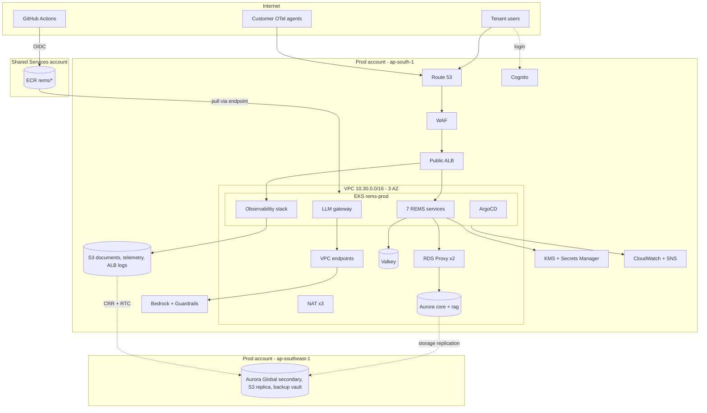
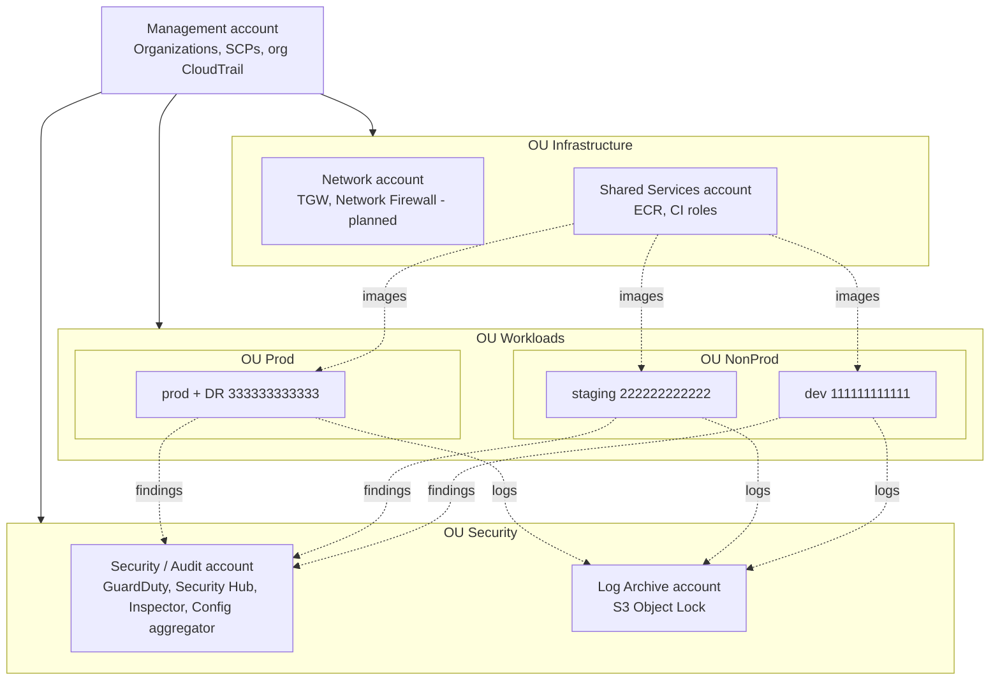
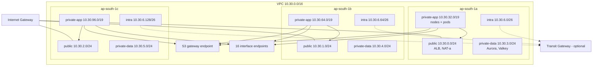
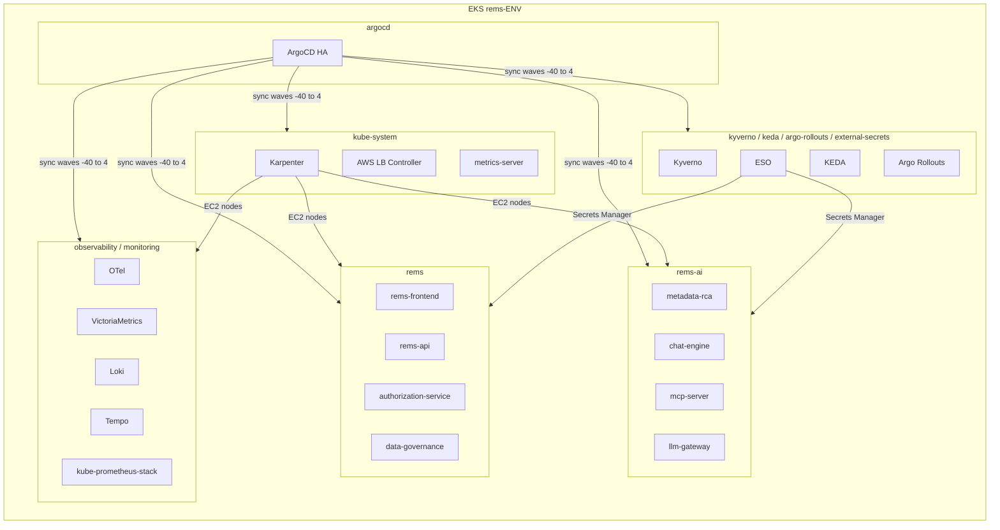
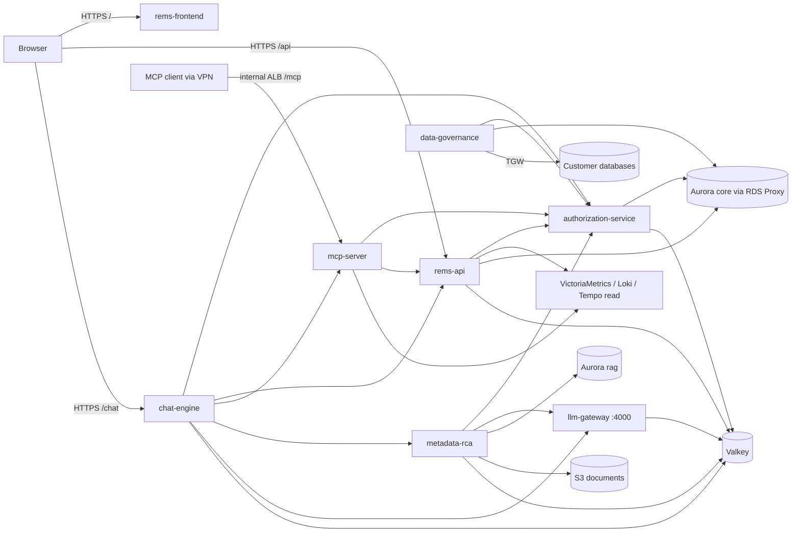
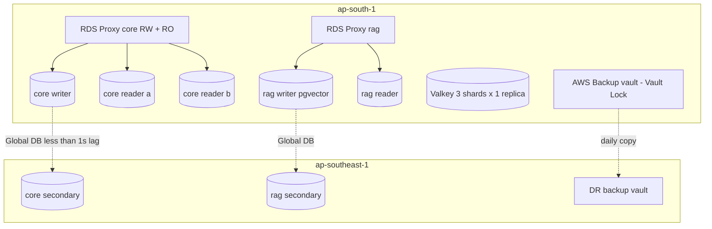
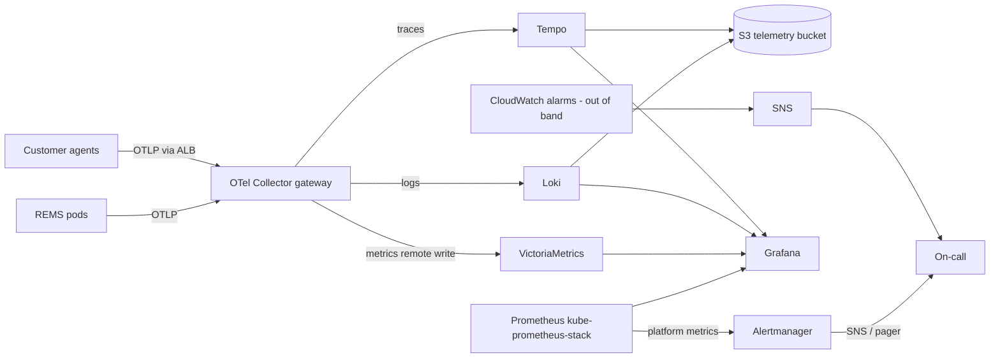
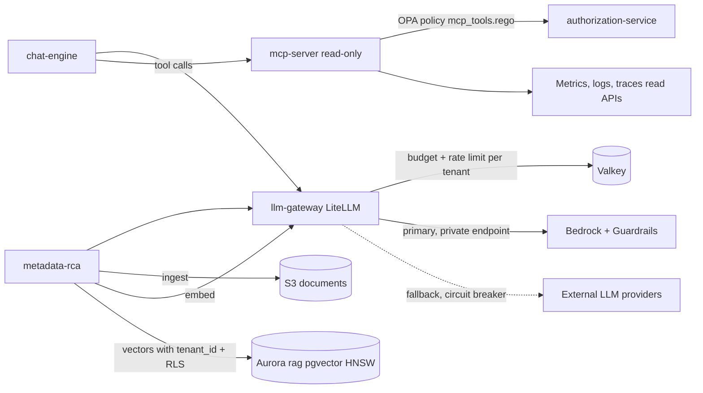
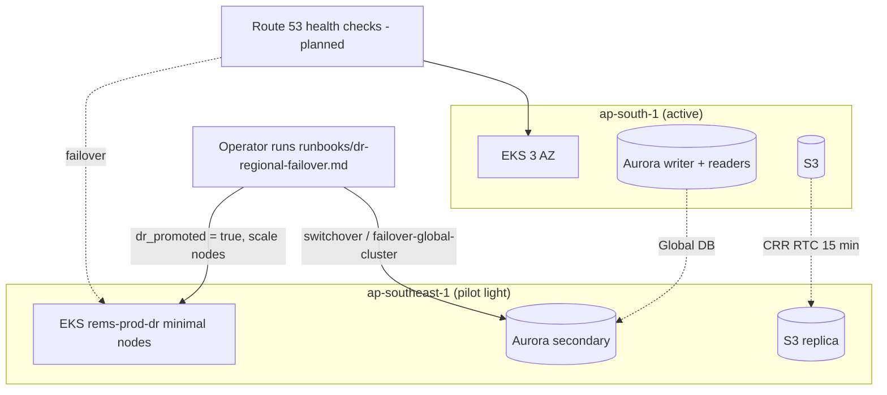

# Architecture Diagrams

All diagrams are Mermaid, so they render on GitHub. They describe what the Terraform, Kubernetes and Helm code in this repository **would** create. ⚠️ Nothing has been deployed. Editable Excalidraw versions (AWS architecture, CI/CD flow, DevSecOps pillars) were produced separately and aren't stored in this repository.

Contents: [1 Complete AWS](#1-complete-aws-architecture) · [2 Multi-account](#2-multi-account-landing-zone) · [3 VPC](#3-vpc-and-subnets) · [4 EKS](#4-eks-deployment) · [5 App communication](#5-application-communication) · [6 CI/CD](#6-cicd-and-gitops) · [7 Database](#7-database) · [8 Observability](#8-observability) · [9 AI / RAG / MCP](#9-ai-rag-and-mcp) · [10 HA / DR](#10-high-availability-and-disaster-recovery)

## 1. Complete AWS architecture

## 2. Multi-account landing zone

## 3. VPC and subnets

## 4. EKS deployment

## 5. Application communication

## 6. CI/CD and GitOps

```mermaid
flowchart LR
  PR[PR merged to main] --> TAG[Date tag YYYY.MM.DD-run]
  TAG --> LINT[Lint + unit tests]
  LINT --> BUILD[docker buildx]
  BUILD --> TRIVY[Trivy image scan<br/>gate: CRITICAL/HIGH]
  TRIVY --> PUSH[Push to ECR + cosign sign]
  PUSH --> CFG[PR to rems-microconfig<br/>apps/SERVICE/values-dev.yaml tag]
  CFG --> AM[Auto-merge dev]
  AM --> ARGO[ArgoCD ApplicationSet]
  ARGO --> EKS[EKS rollout]
  EKS --> AN[Argo Rollouts canary analysis]
  AN -->|fail| RB[Automatic abort]
  CFG -.->|promote workflow: staging, prod with approvals| ARGO
```

## 7. Database

## 8. Observability

## 9. AI, RAG and MCP

## 10. High availability and disaster recovery

## Hand-drawn views (Excalidraw)

