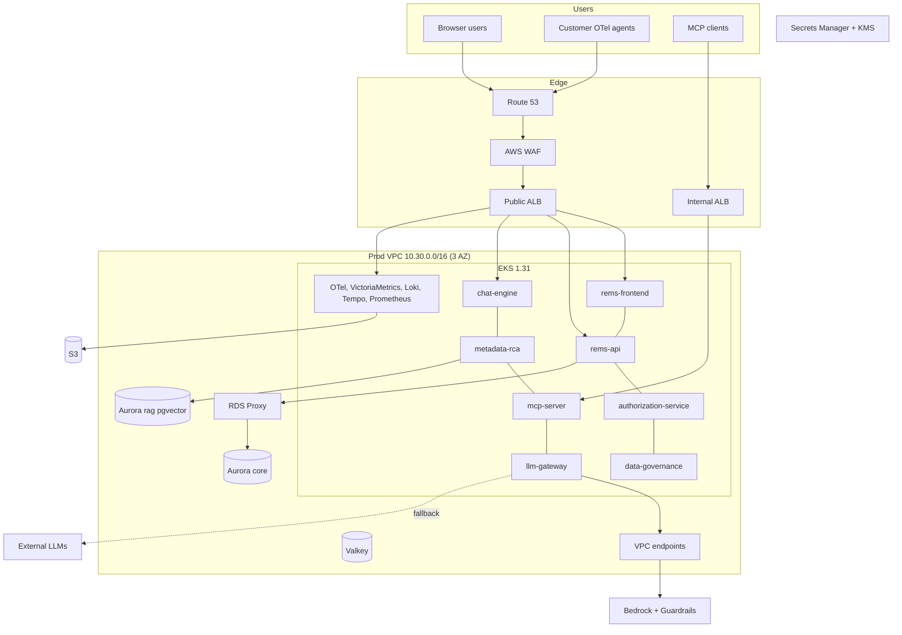

# AWS Architecture

**Status:** ✅ Terraform implemented for all services in this table except those marked 📋. ⚠️ Not deployed.

## Service selection

| AWS service | Used for | Why it was chosen | Terraform |
|---|---|---|---|
| AWS Organizations + SCPs | Multi-account landing zone, guardrails | Preventive controls that even account admins can't bypass | `terraform/landing-zone/` |
| IAM Identity Center | Human access (permission sets) | No IAM users; MFA and short sessions | 📋 permission sets are referenced by ARN in tfvars but not created by Terraform |
| Amazon VPC | 3-AZ network per environment | Isolation, static stability (NAT per AZ) | `terraform/modules/vpc` |
| AWS Transit Gateway / Network Firewall | Customer DB connectivity, egress FQDN filtering | Central hub in the Network account | 🟡 only the VPC *attachment* is implemented (`transit_gateway_id` variable). The TGW and firewall themselves are 📋 |
| Amazon EKS | Container platform | Managed control plane, Pod Identity, access entries | `terraform/modules/eks` |
| Karpenter (on EC2) | Node provisioning | Fast, bin-packed, Spot-aware scaling | `terraform/modules/karpenter`, `kubernetes/base/karpenter.yaml` |
| Elastic Load Balancing (ALB) | Ingress | WAF integration, `target-type: ip`, weighted target groups for canaries | Created by the AWS Load Balancer Controller from Ingress objects |
| AWS WAF | L7 protection | Managed rule groups + rate limits | `terraform/modules/waf` |
| ACM + Route 53 | TLS certificates, DNS validation | Managed certificate renewal | `terraform/modules/rems-environment/edge.tf` (DNS failover records are 📋) |
| Amazon ECR | Container registry (Shared Services account) | Immutable tags, enhanced scanning, cross-region replication | `terraform/modules/ecr`, `terraform/global/shared-services` |
| Aurora PostgreSQL 16 | OLTP (`rems-core`) and vectors (`rems-rag`) | Multi-AZ, Global Database, pgvector | `terraform/modules/aurora-postgresql` |
| RDS Proxy | Connection pooling | Absorbs connection storms, faster failover | same module |
| ElastiCache (Valkey 7.2) | Cache, rate limits, sessions, queues | Multi-AZ cluster mode | `terraform/modules/elasticache-redis` |
| Amazon S3 | RAG documents, telemetry, ALB logs, state, log archive | Durability, lifecycle tiering, CRR with RTC | `terraform/modules/s3-bucket` |
| AWS KMS | Encryption keys per data domain | Customer-managed keys with rotation | `terraform/modules/kms` |
| Secrets Manager | DB, Redis and LLM credentials | Rotation and cross-region replicas | DB/Redis modules, `modules/ai-platform` |
| Amazon Cognito | Identity provider (federates to tenant IdPs) | OIDC tokens with a `tenant_id` claim | `terraform/modules/cognito` |
| Amazon Bedrock | LLM and embeddings, Guardrails | In-region, private endpoint, no training on prompts | `terraform/modules/ai-platform` |
| CloudWatch + SNS + Budgets + Cost Anomaly Detection | Out-of-band alarms, audit log group, cost guardrails | Still pages when the in-cluster stack is down | `terraform/modules/monitoring` |
| CloudTrail (org), GuardDuty, Security Hub, Inspector, Access Analyzer, Config aggregator | Detection | Centralised in the Security / Log Archive accounts | `terraform/landing-zone/security.tf`, `terraform/modules/security-baseline` |
| AWS Backup | Vault Lock + cross-region copies | Immutable backups | `terraform/modules/backup` |
| AWS FIS | AZ / failover drills | Proves the HA design | IAM role in `modules/rems-environment/identities.tf`, templates in `load-testing/chaos/` |

## Complete architecture

More views: [all diagrams](architecture-diagrams.md). Original source: `architecture/01-aws-overview.md`.
