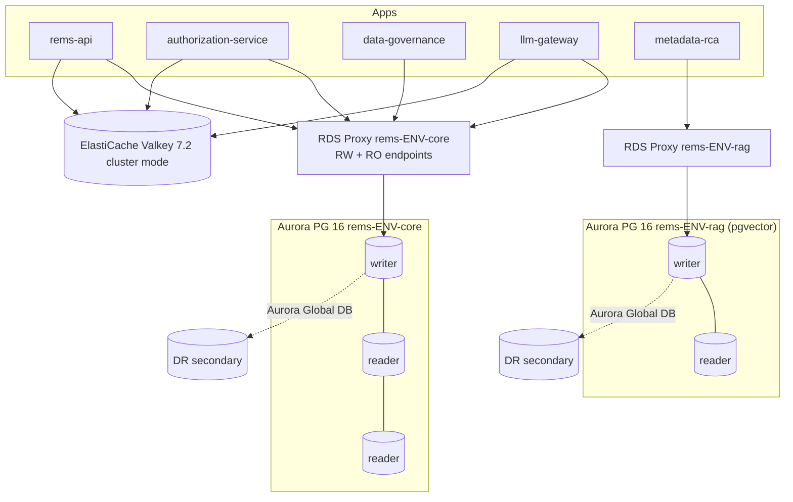

# Database Architecture

**Status:** ✅ Terraform for Aurora, RDS Proxy, Global DB, Valkey and AWS Backup. ✅ SQL and scripts (parsed with the PostgreSQL parser and shellchecked). ⚠️ Never run against a real database.

## Databases and logins

| Cluster | Database | Login role | Terraform `service_users` key → secret `rems/<env>/aurora/<cluster>/<key>` |
|---|---|---|---|
| rems-&lt;env&gt;-core | rems_api | rems_api | `rems-api` |
| rems-&lt;env&gt;-core | rems_authz | rems_authz | `authorization-service` |
| rems-&lt;env&gt;-core | rems_governance | rems_governance | `data-governance` |
| rems-&lt;env&gt;-core | rems_llmgw | rems_llmgw | `llm-gateway` |
| rems-&lt;env&gt;-rag | rems_savvy | rems_savvy | `metadata-rca` |

Defined in `terraform/modules/rems-environment/data.tf` and created in PostgreSQL by `database/scripts/bootstrap-roles.sh`.

## Sizing per environment (`terraform/environments/*/main.tf`)

| Env | core | rag | Valkey |
|---|---|---|---|
| dev | `db.serverless` (0.5–16 ACU), 0 readers | `db.serverless`, 0 readers | `cache.t4g.small`, 1 shard × 1 replica |
| staging | `db.r7g.large`, 1 reader | `db.r7g.large`, 1 reader | `cache.r7g.large`, 2 × 1 |
| prod | `db.r7g.2xlarge`, I/O-Optimized, 2 readers (auto scaling to 5) | `db.r7g.xlarge`, I/O-Optimized, 1 reader (to 3) | `cache.r7g.large`, 3 × 1 |
| prod-dr | Global DB secondary, same classes as prod. Writer only and no RDS Proxy until `dr_promoted = true`, then 2 readers | same rule, 1 reader after promotion | `cache.r7g.large`, 3 × 1 (rebuilt cache, not replicated) |

## Key properties

* Encryption: KMS CMK (storage, Performance Insights), `rds.force_ssl=1`, TLS required on RDS Proxy, Valkey `transit_encryption_mode = "required"` + AUTH token.
* Tenant isolation: RLS with `FORCE ROW LEVEL SECURITY` (`database/sql/03-row-level-security.sql`, `04-pgvector-rag.sql`).
* Backups: PITR 35 days (prod), AWS Backup daily copy to DR vault + monthly 1-year (tag `backup=rems-critical`).

Step-by-step: [PostgreSQL setup](../08-database/postgresql-setup.md), [Redis setup](../08-database/redis-setup.md), [pooling](../08-database/connection-pooling.md), [backup & restore](../08-database/backup-and-restore.md), [DR](../08-database/disaster-recovery.md).
