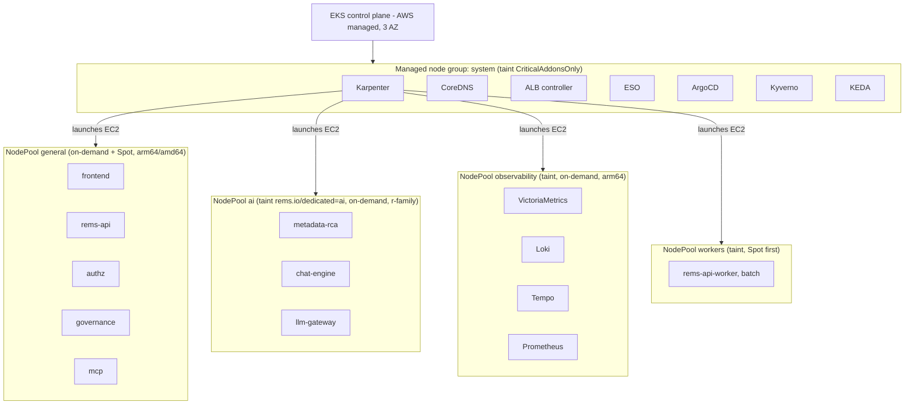

# EKS Architecture

**Status:** ✅ Terraform (`terraform/modules/eks`, `terraform/modules/karpenter`) and manifests (`kubernetes/base/karpenter.yaml`). ⚠️ Not deployed.

## Cluster design

| Aspect | Implementation | Source |
|---|---|---|
| Version | Kubernetes 1.31, `STANDARD` support policy | `kubernetes_version`, `support_type` in `modules/eks/variables.tf` |
| API endpoint | Private, plus optional public endpoint restricted by CIDR (dev) | `endpoint_public_access*` |
| Auth | `authentication_mode = "API"` (EKS access entries, no `aws-auth` ConfigMap). The cluster creator doesn't get admin automatically | `access_config` in `modules/eks/main.tf` |
| Secrets | Envelope encryption with the `eks` KMS key | `encryption_config` |
| Logging | api, audit, authenticator, controllerManager, scheduler → CloudWatch `/aws/eks/<cluster>/cluster` | `enabled_cluster_log_types` |
| Add-ons (managed) | vpc-cni (prefix delegation, network policy), kube-proxy, eks-pod-identity-agent, coredns (3 replicas spread across zones), aws-ebs-csi-driver (Pod Identity), amazon-cloudwatch-observability | `aws_eks_addon.*`, `modules/rems-environment/observability.tf` |
| Workload identity | EKS Pod Identity, one IAM role per service account | `terraform/modules/pod-identity`, `modules/rems-environment/identities.tf` |
| IMDS | Hop limit 1 (pods can't reach node credentials) | `aws_launch_template.system`, EC2NodeClass `metadataOptions` |

## Compute pools

| Pool | Defined in | Capacity type | Disruption |
|---|---|---|---|
| system (managed node group) | `aws_eks_node_group.system` | on-demand, `m7g.large` × 3 in prod (`t4g.large` × 2 in dev) | rolling, max unavailable 1 |
| general | `kubernetes/base/karpenter.yaml` | on-demand + Spot (Spot only in dev via overlay) | `WhenEmptyOrUnderutilized`, 10 % budget |
| ai | same | on-demand, r7g/r6g/r7i/r6i | no disruption 09:00–19:00 IST on weekdays |
| observability | same | on-demand, arm64 | `WhenEmpty`, 1 node at a time |
| workers | same | Spot first | aggressive consolidation |

## Scheduling and zero-downtime rules (from `helm/charts/rems-common`)

* Topology spread across `topology.kubernetes.io/zone` and `kubernetes.io/hostname` (`ScheduleAnyway`, so a lost AZ never blocks rescheduling).
* Tolerations of 60 s for `node.kubernetes.io/not-ready` / `unreachable`, so pods are evicted from failed nodes faster than the 300 s default.
* PriorityClasses: `rems-critical`, `rems-high`, `rems-batch` and `rems-overprovision` (`kubernetes/base/priority-classes.yaml`).
* `preStop` sleep (15 s), readiness gates (`elbv2.k8s.aws/pod-readiness-gate-inject` namespace label), `maxUnavailable: 0`, PDBs.

Setup steps: [EKS setup](../02-aws-infrastructure/eks-setup.md), [cluster configuration](../04-kubernetes/cluster-configuration.md).
