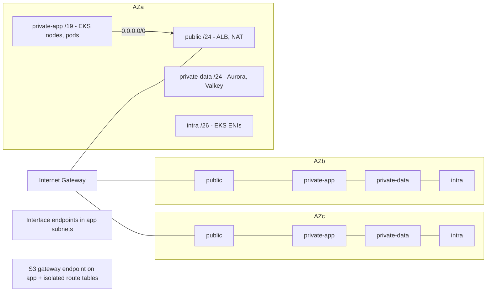

# Network Architecture

**Status:** ✅ VPC, subnets, NAT, endpoints, flow logs (`terraform/modules/vpc`). 🟡 Transit Gateway attachment only. 📋 Network Firewall / inspection VPC.

## Subnet plan (implemented in `terraform/modules/vpc/main.tf`, `locals`)

Each environment gets one /16 with three tiers per AZ. The CIDRs are computed with `cidrsubnet()`, so they are deterministic:

| Tier | Size per AZ | Formula | Prod example (10.30.0.0/16) | Route |
|---|---|---|---|---|
| public | /24 | `cidrsubnet(cidr, 8, i)` | 10.30.0.0/24, .1.0, .2.0 | IGW |
| private-data | /24 | `cidrsubnet(cidr, 8, 3+i)` | 10.30.3.0/24, .4.0, .5.0 | **none** (isolated) |
| intra | /26 | `cidrsubnet(cidr, 10, 24+i)` | 10.30.6.0/26, .6.64, .6.128 | none (+TGW if attached) |
| private-app | /19 | `cidrsubnet(cidr, 3, 1+i)` | 10.30.32.0/19, .64.0/19, .96.0/19 | NAT in the **same** AZ |

| Environment | VPC CIDR (from `terraform/environments/*/main.tf`) | NAT gateways |
|---|---|---|
| dev | 10.10.0.0/16 | 1 (`single_nat_gateway = true`) |
| staging | 10.20.0.0/16 | 3 |
| prod | 10.30.0.0/16 | 3 |
| prod-dr | 10.40.0.0/16 | 3 |

## Why this layout

* **/19 app subnets + VPC CNI prefix delegation** give enough pod IPs for > 1 000 nodes per AZ without a secondary CIDR (`ENABLE_PREFIX_DELEGATION=true` in `terraform/modules/eks/main.tf`).
* **The data tier has no default route.** Aurora and Valkey can't reach the internet even if a security group is misconfigured.
* **A NAT per AZ** (staging, prod and DR) keeps egress working when one AZ fails.
* **Interface endpoints** (16 by default, `interface_endpoints` variable) keep AWS API traffic private and off NAT data-processing charges.

## Security boundaries

| Layer | Control | File |
|---|---|---|
| VPC default SG | Locked down (no rules) | `aws_default_security_group.this` in `modules/vpc/main.tf` |
| Endpoint SG | 443 from VPC CIDR only | `aws_security_group.endpoints` |
| Aurora / RDS Proxy SG | 5432 only from the EKS cluster SG | `modules/aurora-postgresql/main.tf` |
| Valkey SG | 6379 only from the EKS cluster SG | `modules/elasticache-redis/main.tf` |
| EKS API | Private endpoint, plus optional CIDR-restricted public endpoint (dev only) | `modules/eks/main.tf` |
| Pods | Default-deny NetworkPolicies + per-chart allow-lists | `kubernetes/base/network-policies.yaml`, `helm/charts/rems-common/templates/_networking.tpl` |
| Flow logs | All traffic, 60 s aggregation, to CloudWatch or the Log Archive S3 bucket | `aws_flow_log.this` |

Step-by-step setup: [VPC setup](../02-aws-infrastructure/vpc-setup.md), [subnets](../02-aws-infrastructure/subnet-configuration.md), [security groups](../02-aws-infrastructure/security-groups.md), [VPC endpoints](../02-aws-infrastructure/vpc-endpoints.md).
