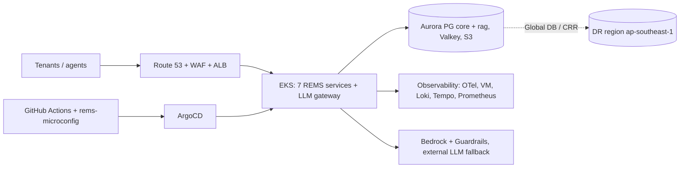

# Architecture Overview

> **Status legend used across `docs/`:** ✅ implemented in this repository and validated offline · 🟡 partially implemented / contains placeholders · 📋 planned (design only) · ⚠️ not yet validated against a real AWS account. Nothing in this repository has been deployed by the author of these docs. See [IMPLEMENTATION-STATUS.md](../IMPLEMENTATION-STATUS.md).

## 1. What REMS is

REMS is an enterprise observability and reliability management platform. The [problem statement](../../documentation/01-requirements-checklist.md) asks for a production AWS platform for these components:

| # | Component | Technology (from the PDF) | Chart / config in this repo |
|---|---|---|---|
| 1 | Frontend | React/Vite (dashboards, alerts, incidents, admin) | `helm/charts/rems-frontend` |
| 2 | REMS API | FastAPI + PostgreSQL, Prometheus/VictoriaMetrics, Loki, Tempo, Kubernetes | `helm/charts/rems-api` |
| 3 | Authorization Service | RBAC, tenant permissions, policy enforcement, audit logging | `helm/charts/authorization-service`, `security/opa/` |
| 4 | Data Governance | DB scanning, governance policies, PostgreSQL/MySQL integrations | `helm/charts/data-governance` |
| 5 | Metadata RCA / Savvy | RCA, SOPs, RAG, documents, pgvector, LLM | `helm/charts/metadata-rca`, `database/sql/04-pgvector-rag.sql` |
| 6 | Chat Engine | AI analysis of incidents, alerts, infra, logs and traces | `helm/charts/chat-engine` |
| 7 | MCP Server | Secure tools for querying REMS observability data | `helm/charts/mcp-server`, `ai-infrastructure/mcp/` |
| 8 | Supporting infra | PostgreSQL, Redis, object storage, IdP, observability backends, secrets, AI providers | `terraform/modules/*`, `monitoring/`, `ai-infrastructure/` |

## 2. Non-functional targets (PDF)

| Target | Value | Where it is addressed |
|---|---|---|
| Availability | 99.95 % | [HA](../11-ha-dr/high-availability.md) |
| Single-AZ failure | automatic recovery | [HA](../11-ha-dr/high-availability.md), `runbooks/az-failure.md` |
| DR | RPO 15 min, RTO 2 h (critical services) | [DR](../11-ha-dr/disaster-recovery.md) |
| Tenants | 20 initially, 100+ target | [capacity plan](../../documentation/05-capacity-plan.md) |
| Load | 50 M events/day, 5× peaks | [k6 testing](../12-testing/k6-load-testing.md) |
| Telemetry retention | 30–90 days | [Loki](../09-monitoring/loki.md), [Tempo](../09-monitoring/tempo.md) |
| Environments | dev, staging, prod (+ prod-dr) | `terraform/environments/` |

## 3. Architecture at a glance

## 4. Key design decisions

| Decision | Choice | Why (trade-off) |
|---|---|---|
| Regions | ap-south-1 primary, ap-southeast-1 DR | India-based team, full service availability in Singapore (assumption A1 in `documentation/02-assumptions.md`) |
| Accounts | AWS Organizations with Security, Log Archive, Network, Shared Services and dev/staging/prod accounts | Blast-radius isolation, central guardrails (SCPs) |
| Compute | EKS + Karpenter, Graviton, Spot for burst/workers | Independent scaling per service, cost |
| Data | Aurora PostgreSQL 16 (two clusters), RDS Proxy, ElastiCache Valkey | Managed HA, pgvector support, OLTP isolated from vector search |
| Tenancy | Pooled model with 5 isolation layers, silo option for regulated tenants | Cost-efficient at 20–100 tenants |
| Delivery | GitHub Actions (OIDC) → ECR → rems-microconfig PR → ArgoCD → Argo Rollouts canary | GitOps audit trail, automatic rollback |
| AI | LLM gateway (LiteLLM) in front of Bedrock with external fallback | Quotas, budgets, failover, data protection |
| Observability | OTel + VictoriaMetrics + Loki + Tempo + kube-prometheus-stack + CloudWatch out-of-band | The product's own stack, and an independent alerting path when it fails |

## 5. Where to go next

* Detailed views: [AWS](aws-architecture.md) · [Network](network-architecture.md) · [EKS](eks-architecture.md) · [Application](application-architecture.md) · [Database](database-architecture.md) · [All diagrams](architecture-diagrams.md)
* Original design documents (more depth, same content): [`architecture/`](../../architecture/README.md)
