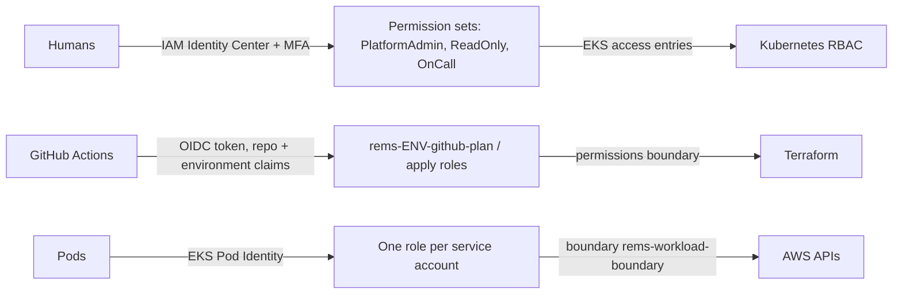

# IAM Configuration

**Status:** ✅ GitHub OIDC roles, permission boundaries, Pod Identity roles, Karpenter/EKS/FIS roles (Terraform). 📋 Identity Center permission sets (manual). ⚠️ Not applied.

## Objective

Every principal gets short-lived credentials and least-privilege permissions. There are no IAM users and no access keys anywhere (SCP `deny-iam-users-and-keys`).

## Prerequisites

[Landing zone](aws-account-setup.md) applied, so the account IDs are known.

## Identity model



| Principal | Created by | File |
|---|---|---|
| GitHub plan/apply roles per environment | `module "github_oidc"` | `terraform/global/bootstrap/main.tf`, `terraform/modules/github-oidc` |
| ECR push role (Shared Services) | `terraform/global/shared-services/main.tf` | output `ecr_push_role_arn` |
| Terraform permission boundary | JSON template | `security/iam/permission-boundary-terraform.json` |
| Workload permission boundary | JSON template | `security/iam/permission-boundary-workload.json` → output `workload_permissions_boundary_arn` |
| EKS cluster / node roles | `terraform/modules/eks` | – |
| Karpenter controller + node role | `terraform/modules/karpenter` | – |
| Service roles (Pod Identity) | `terraform/modules/pod-identity`, called from `terraform/modules/rems-environment/identities.tf` | – |
| FIS experiment role | `aws_iam_role.fis` (when `enable_fis = true`) | `modules/rems-environment/identities.tf` |

## Steps

1. Bootstrap each workload account. This creates the state bucket, OIDC provider, plan/apply roles and boundaries:

   ```bash
   cd terraform/global/bootstrap
   # edit dev.tfvars / staging.tfvars / prod.tfvars: account_id, github_org, admin_role_arns
   for env in dev staging prod; do
     AWS_PROFILE=rems-${env}-admin terraform init -reconfigure
     AWS_PROFILE=rems-${env}-admin terraform apply -var-file=${env}.tfvars -state=${env}.tfstate
   done
   ```

2. Record the outputs:

   ```bash
   terraform output -state=prod.tfstate github_role_arns
   terraform output -state=prod.tfstate workload_permissions_boundary_arn
   ```

   * `github_role_arns` → GitHub **Environment** variables `AWS_ROLE_PLAN` / `AWS_ROLE_APPLY` (used by `.github/workflows/terraform.yml`).
   * `workload_permissions_boundary_arn` → `permissions_boundary_arn` in `terraform/environments/<env>/terraform.tfvars`.

3. Shared Services:

   ```bash
   cd terraform/global/shared-services
   AWS_PROFILE=rems-shared-admin terraform init -backend-config=backend.hcl
   AWS_PROFILE=rems-shared-admin terraform apply
   terraform output ecr_push_role_arn   # GitHub org variable AWS_ECR_PUSH_ROLE
   ```

4. Map human roles to Kubernetes through EKS access entries. `access_entries` in `terraform/environments/prod/main.tf` uses `platform_admin_role_arn`, `readonly_role_arn`, `oncall_role_arn` and `cicd_deploy_role_arn`.

## Configuration explained: OIDC trust

The trust policy in `terraform/modules/github-oidc` restricts `token.actions.githubusercontent.com:sub` to the platform repository **and** a GitHub environment, so a branch in a fork can't assume the apply role. The audience is `sts.amazonaws.com`.

Example of a Pod Identity association (from `terraform/modules/pod-identity`):

```hcl
resource "aws_eks_pod_identity_association" "this" {
  cluster_name    = var.cluster_name
  namespace       = var.namespace
  service_account = var.service_account
  role_arn        = aws_iam_role.this.arn
}
```

The Kubernetes side is a plain ServiceAccount (created by each chart, `serviceAccount.create: true`). Pod Identity needs no annotation.

## Verification

```bash
aws iam list-open-id-connect-providers
aws iam get-role --role-name <github-apply-role-name> --query 'Role.AssumeRolePolicyDocument'
aws eks list-pod-identity-associations --cluster-name rems-prod --region ap-south-1
aws eks list-access-entries --cluster-name rems-prod --region ap-south-1
aws accessanalyzer list-findings --analyzer-arn <analyzer-arn> --filter '{"status":{"eq":["ACTIVE"]}}'
```

## Security considerations

* The boundaries cap what Terraform-created roles can ever do, even if a policy is too broad. The workload boundary denies IAM, Organizations and KMS key administration.
* `protect-security-roles` (SCP) stops workload accounts from modifying the OIDC and break-glass roles.
* Use the plan role for PRs (read-only) and the apply role only from protected environments with required reviewers.

## Troubleshooting

| Symptom | Fix |
|---|---|
| `Not authorized to perform sts:AssumeRoleWithWebIdentity` | The `sub` claim doesn't match. Check that the workflow job sets `environment:` and the repo name/owner casing |
| Pod gets node-role credentials | The pod-identity-agent add-on is missing, or no association exists for that namespace/SA |
| `AccessDenied` despite an allow | Permission boundary or SCP. Check with `aws iam simulate-principal-policy --policy-source-arn <role> --action-names <action>` |

## Rollback

Roles are stateless. Revert the Terraform change and apply. Never delete the OIDC provider while workflows depend on it. Remove the GitHub variables first.
