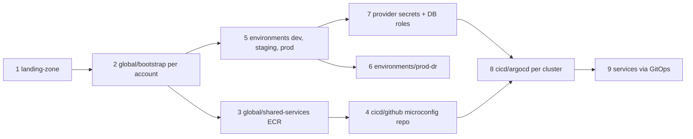

# Infrastructure Deployment (end-to-end order)

**Status:** ✅ Every stack listed exists in the repository and passes the offline validation. ⚠️ **No stack has been applied to AWS.** Each `apply` below creates billable resources and needs explicit approval.

## Objective

Bring up the entire REMS platform from an empty organization, in dependency order.

## Prerequisites

| Tool | Version |
|---|---|
| Terraform | ≥ 1.10 (S3 native locking `use_lockfile = true`) |
| AWS CLI | v2 with Identity Center profiles per account |
| kubectl / kustomize / Helm | 1.31 / 5.x / 3.16 |
| gh, argocd, jq, psql 16 | current |

Replace placeholders first:

```bash
grep -rn PLACEHOLDER --include=*.tf --include=*.tfvars --include=*.hcl --include=*.yaml . | wc -l
grep -rn 'example.com\|your-github-org' --include=*.tfvars --include=*.yaml . | head
./scripts/validate.sh     # offline, no AWS access needed
```

## Order of stacks



| # | Stack | Account / profile | Command |
|---|---|---|---|
| 1 | `terraform/landing-zone` | management | see [account setup](aws-account-setup.md) |
| 2 | `terraform/global/bootstrap` | each workload account | `terraform apply -var-file=<env>.tfvars -state=<env>.tfstate` |
| 3 | `terraform/global/shared-services` | shared services | `terraform init -backend-config=backend.hcl && terraform apply` |
| 4 | `terraform/cicd/github` | GitHub org (token) | see [GitHub Actions](../06-cicd/github-actions.md) |
| 5 | `terraform/environments/{dev,staging,prod}` | each workload account | below |
| 6 | `terraform/environments/prod-dr` | prod account, ap-southeast-1 | below |
| 7 | Secrets Manager values, `database/scripts/bootstrap-roles.sh` | prod | [secrets](../07-security/secrets-management.md), [PostgreSQL](../08-database/postgresql-setup.md) |
| 8 | `terraform/cicd/argocd` | each cluster | [ArgoCD setup](../06-cicd/argocd-setup.md) |

## Step 5: deploy an environment

```bash
cd terraform/environments/dev
export AWS_PROFILE=rems-dev-admin
terraform init -backend-config=backend.hcl
terraform plan -out=tfplan
terraform show -no-color tfplan | grep -E '^Plan:'    # review the resource count
terraform apply tfplan
```

Repeat for `staging` and `prod`. In CI, `.github/workflows/terraform.yml` runs `plan` on PRs and `apply` from protected GitHub Environments.

## Step 6: DR site

```bash
cd terraform/environments/prod-dr
export AWS_PROFILE=rems-prod-admin
terraform init -backend-config=backend.hcl
# Break-glass only (ap-south-1 unavailable): use the replicated state bucket in ap-southeast-1
#   terraform init -reconfigure -backend-config=backend-dr-region.hcl
terraform plan -out=tfplan && terraform apply tfplan
```

`prod-dr` reads the prod outputs (`dr.global_cluster_ids`, `dr.kms_key_arns`, …) through `terraform_remote_state` (`prod_state_bucket`, `prod_state_region`). Keep `dr_promoted = false` until a failover.

## Outputs to copy into GitOps values

| Output (`terraform output -json <name>`) | Destination |
|---|---|
| `edge.waf_acl_arn`, `edge.certificate_arn`, `buckets.alb_logs` | `helm/environments/<env>/global.yaml` (`global.ingress.*`) |
| `cluster_name`, `karpenter.interruption_queue`, `karpenter.node_role_name` | `kubernetes/platform-addons/karpenter/values-<env>.yaml`, `kubernetes/overlays/<env>` |
| VPC ID (🟡 not exported at the environment root, see below) | `kubernetes/platform-addons/aws-load-balancer-controller/values-<env>.yaml` |
| SNS alert topic (🟡 module output `alerts_topic_arn`, not re-exported) | `monitoring/kube-prometheus-stack/values.yaml` |
| `buckets.telemetry` | `monitoring/loki/values.yaml`, `monitoring/tempo/values.yaml` |
| `aurora.core_proxy_endpoint`, `ai.guardrail_id`, `ai.guardrail_version` | `ai-infrastructure/llm-gateway/values.yaml` |
| `cognito.issuer_url`, `cognito.*_client_id` | service config (app-specific, pending) |

🟡 **Gap:** `terraform/environments/*/outputs.tf` doesn't re-export the module outputs `vpc_id` and `alerts_topic_arn`. Until those outputs are added, read them with:

```bash
aws eks describe-cluster --name rems-prod --region ap-south-1 --query cluster.resourcesVpcConfig.vpcId --output text
aws sns list-topics --query "Topics[?contains(TopicArn,'rems-prod')]"
```

## Verification (whole environment)

```bash
terraform -chdir=terraform/environments/prod output
aws eks describe-cluster --name rems-prod --region ap-south-1 --query cluster.status
aws rds describe-db-clusters --region ap-south-1 --query 'DBClusters[].{id:DBClusterIdentifier,status:Status,engine:EngineVersion}'
aws elasticache describe-replication-groups --region ap-south-1 --query 'ReplicationGroups[].{id:ReplicationGroupId,status:Status}'
./scripts/smoke-test.sh https://<app-hostname> rems-prod     # after the services are deployed
```

## Security considerations

* Run applies only through the GitHub apply role or a PlatformAdmin session. Never use long-lived keys.
* Review every plan for `destroy` / `replace` actions on data stores. Prod sets `deletion_protection = true`.
* State is encrypted with the `rems-tfstate` KMS key and versioned. Prod state is replicated to the DR region.

## Troubleshooting

See [Terraform troubleshooting](../03-terraform/troubleshooting.md).

## Rollback

* Code: `git revert` the change, then `terraform plan` / `apply`.
* State corruption: restore the previous object version of `terraform.tfstate` from the versioned state bucket (`aws s3api list-object-versions --bucket <state-bucket> --prefix rems/prod/`).
* Full teardown, **dev only**: `terraform -chdir=terraform/environments/dev destroy` after removing the ArgoCD applications.
