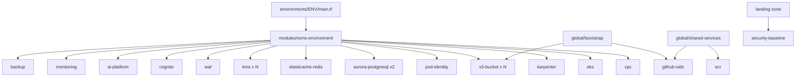

# Terraform Project Structure

**Status:** ✅ 26 Terraform directories parse and wire correctly (`scripts/tf_static_check.py`). Checkov: 1 428 passed, 0 failed.

```text
terraform/
├── landing-zone/            # Organizations, OUs, accounts, SCPs, org trail, delegated security (mgmt account)
├── global/
│   ├── bootstrap/           # per account: state bucket (+DR replica), GitHub OIDC roles, permission boundaries
│   └── shared-services/     # ECR repositories, replication, image push role
├── environments/
│   ├── dev/  staging/  prod/  prod-dr/   # thin roots: versions.tf, main.tf, variables.tf, outputs.tf, terraform.tfvars, backend.hcl
├── cicd/
│   ├── github/              # rems-microconfig repo, branch protection, CODEOWNERS, workflows, service repo CI vars
│   └── argocd/              # ArgoCD HA, AppProjects, root app, rems-services ApplicationSet (per cluster)
└── modules/
    ├── rems-environment/    # composition module: everything one environment needs
    ├── vpc/  eks/  karpenter/  pod-identity/
    ├── aurora-postgresql/  elasticache-redis/  s3-bucket/  kms/  backup/
    ├── waf/  cognito/  ai-platform/  monitoring/  security-baseline/
    ├── ecr/  github-oidc/
```

## Layering



## `rems-environment` files

| File | Contents |
|---|---|
| `main.tf` | locals (name `rems-<env>` or `rems-<env>-dr`, tags), data sources, EBS encryption by default |
| `kms.tf` | One CMK per domain: eks, ebs, aurora, elasticache, s3, secrets, logs, sns, backup. DR-region keys for aurora, secrets, s3, backup when `enable_dr_replication = true` |
| `network.tf` | `module "vpc"` |
| `eks.tf` | `module "eks"`, `module "karpenter"` |
| `identities.tf` | Pod Identity roles (modules `irsa_alb_controller`, `irsa_external_dns`, `irsa_external_secrets`, `irsa_alertmanager`, `irsa_otel_collector`, `irsa_telemetry`, `irsa_llm_gateway`, `irsa_metadata_rca`, `irsa_data_governance`), FIS role |
| `data.tf` | Aurora core + rag, Valkey, service users |
| `storage.tf` | S3 buckets (documents, telemetry, ALB logs), DR documents replica, AWS Backup plan + DR vault |
| `edge.tf` | WAF, ACM certificate + Route 53 validation records, Cognito |
| `observability.tf` | CloudWatch observability add-on + agent role, `module "monitoring"` (alarms, budgets), `module "ai_platform"` |
| `policies/` | IAM policy JSON templates used by `identities.tf` |
| `outputs.tf` | `cluster_name`, `vpc_id`, `karpenter`, `aurora`, `redis`, `buckets`, `edge`, `cognito`, `ai`, `alerts_topic_arn`, `dr`, `fis_role_arn` |

## Conventions

* Environment roots contain **no resources**, only one module call plus providers. Differences between environments are visible in one `main.tf` diff.
* Two AWS providers per root: default (primary region) and `aws.dr` (DR region; equals the primary region in dev/staging).
* `default_tags`: `Project`, `Environment`, `ManagedBy`, `Repository`.
* No secrets in `.tfvars`. Generated passwords (`random_password`) go straight to Secrets Manager. State is KMS-encrypted.

## Verification

```bash
python3 scripts/tf_static_check.py terraform
find terraform -name '*.tf' -not -path '*/.terraform/*' -exec dirname {} \; | sort -u | wc -l   # 26
```
