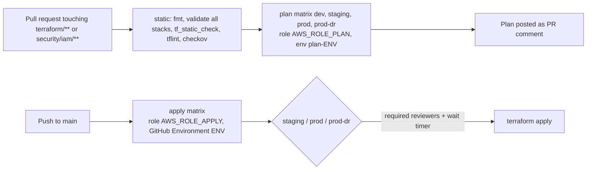

# Terraform Deployment

**Status:** ✅ Local procedure and CI workflow (`.github/workflows/terraform.yml`). ⚠️ Never executed against AWS.

## Objective

Plan and apply the stacks safely, locally for the first run and through GitHub Actions afterwards.

## Prerequisites

[Installation](installation.md), [backend](backend-configuration.md), [environment tfvars](environment-configuration.md).

## Local (first run / break-glass)

```bash
cd terraform/environments/dev
export AWS_PROFILE=rems-dev-admin
terraform fmt -check -recursive ../..
terraform init -backend-config=backend.hcl
terraform validate
terraform plan -out=tfplan
terraform show tfplan | less
terraform apply tfplan
```

## CI pipeline (`.github/workflows/terraform.yml`)



Workflow facts:

* `TF_VERSION: "1.10.3"`, `concurrency: terraform-${{ github.ref }}` with `cancel-in-progress: false` (an apply is never cancelled mid-way).
* Plan jobs run in GitHub Environments `plan-<env>`. Apply jobs run in `<env>`.
* Credentials come only from OIDC (`aws-actions/configure-aws-credentials`) with `vars.AWS_ROLE_PLAN` / `vars.AWS_ROLE_APPLY`.

### GitHub settings required (📋 manual, per repository)

| Item | Value |
|---|---|
| Environments | `plan-dev`, `plan-staging`, `plan-prod`, `plan-prod-dr`, `dev`, `staging`, `prod`, `prod-dr` |
| Environment variables | `AWS_ROLE_PLAN` (plan-*), `AWS_ROLE_APPLY` (others), from `terraform/global/bootstrap` output `github_role_arns` |
| Protection | Required reviewers on `staging` (1) and `prod`, `prod-dr` (2), wait timer for prod |

```bash
gh api -X PUT repos/<owner>/<repo>/environments/prod \
  -F wait_timer=10 -F 'reviewers[][type]=Team' -F 'reviewers[][id]=<team-id>'
gh variable set AWS_ROLE_APPLY --env prod --body "<apply-role-arn>"
```

## Verification

* The PR shows a plan comment per environment.
* `terraform plan` after apply shows `No changes.`

## Security considerations

* Plan roles are read-only. Apply roles can only be assumed from protected environments (OIDC `sub` condition).
* Watch for `-/+` (replace) on `aws_rds_cluster`, `aws_eks_cluster` and `aws_elasticache_replication_group`. Treat it as a stop signal.

## Troubleshooting

See [troubleshooting](troubleshooting.md).

## Rollback

`git revert` the merge commit. The push to `main` re-applies the previous configuration. For destructive changes that already happened (for example a replaced DB), restore from backup: [backup & restore](../08-database/backup-and-restore.md).
