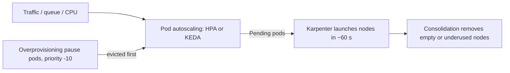

# Autoscaling

**Status:** ✅ HPA / KEDA ScaledObjects (`helm/charts/rems-common/templates/_scaling.tpl`), Karpenter NodePools (`kubernetes/base/karpenter.yaml`), overprovisioning (`kubernetes/base/storage-and-capacity.yaml`). ⚠️ Thresholds are capacity-plan estimates (`documentation/05-capacity-plan.md`). Calibrate them with k6 results.

## Three layers



## Pod autoscaling per service (prod, from rendered charts)

| Service | Kind | Min–Max | Triggers |
|---|---|---|---|
| rems-api | KEDA ScaledObject | 6–40 | CPU 65 %, Prometheus `sum(rate(http_server_request_duration_seconds_count{service_name="rems-api"}[2m]))` threshold 80 |
| chat-engine | KEDA | 3–20 | CPU 70 % + Prometheus `sum(http_server_active_requests{service_name="chat-engine"})` |
| metadata-rca | KEDA | 2–12 | CPU 70 % + Prometheus `sum(http_server_active_requests{service_name="metadata-rca"})` |
| authorization-service | HPA | 3–20 | CPU 60 % |
| rems-frontend | HPA | 3–10 | CPU 70 % |
| data-governance | HPA | 2–10 | CPU 70 % |
| mcp-server | HPA | 2–10 | CPU 60 % |

🟡 The Prometheus metrics `http_server_request_duration_seconds_count` and `http_server_active_requests` are the OpenTelemetry HTTP semantic-convention name. They only exist if the service is instrumented with OTel HTTP metrics (to be confirmed per service).

Scale behaviour (rems-api): scale up +100 % or +4 pods every 15 s (whichever is larger), no stabilization. Scale down at most 10 %/min after a 300 s window.

## Real rendered ScaledObject (rems-api, prod)

```yaml
apiVersion: keda.sh/v1alpha1
kind: ScaledObject
metadata:
  name: rems-api
  namespace: rems
spec:
  scaleTargetRef:
    apiVersion: argoproj.io/v1alpha1
    kind: Rollout
    name: rems-api
  minReplicaCount: 6
  maxReplicaCount: 40
  pollingInterval: 15
  cooldownPeriod: 300
  triggers:
    - type: cpu
      metricType: Utilization
      metadata:
        value: "65"
    - type: prometheus
      metadata:
        serverAddress: "http://kube-prometheus-stack-prometheus.monitoring.svc:9090"
        query: "sum(rate(http_server_request_duration_seconds_count{service_name=\"rems-api\"}[2m]))"
        threshold: "80"
```

## Node autoscaling (Karpenter)

| NodePool | Use | Notes |
|---|---|---|
| general | Most REMS services | arm64 + amd64, on-demand floor + Spot (Spot-heavy in dev) |
| ai | chat-engine, metadata-rca, llm-gateway | Taint `rems.io/dedicated=ai`, memory-optimized, no disruption in business hours |
| observability | VM, Loki, Tempo, Prometheus | Taint, `WhenEmpty` consolidation |
| workers | Batch / async | Spot first |

Overprovisioning: a `pause` Deployment with PriorityClass `rems-overprovision` (-10) keeps headroom. The prod overlay sets 3 replicas. Real pods preempt it instantly while Karpenter adds capacity.

## Verification

```bash
kubectl get hpa,scaledobjects -A
kubectl get nodeclaims -o wide
kubectl -n kube-system logs deploy/karpenter --since=10m | grep -i -E 'launched|disrupt'
# Load test (staging): see ../12-testing/k6-load-testing.md
```

## Troubleshooting

| Symptom | Fix |
|---|---|
| ScaledObject `Ready=False` | KEDA can't reach Prometheus. The NetworkPolicy must allow KEDA → monitoring:9090 |
| HPA `<unknown>` CPU | metrics-server is down, or the pod has no CPU requests |
| Nodes not launching | `kubectl describe nodeclaim`: instance type unavailable, subnet IPs, or EC2 quota (vCPU limits) |
| Thrashing | Raise `stabilizationWindowSeconds` (values `autoscaling.behavior`) |

## Rollback

Revert the values. To freeze scaling during an incident, pause KEDA on one object:

```bash
kubectl annotate scaledobject rems-api -n rems autoscaling.keda.sh/paused-replicas="12" --overwrite
```
