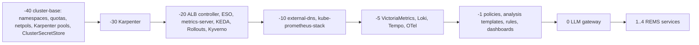

# ArgoCD Setup

**Status:** ✅ Two equivalent paths. (A) Terraform `terraform/cicd/argocd` (ArgoCD HA via Helm, read-only deploy keys, AppProjects, platform root app, rems-services ApplicationSet). (B) Script `scripts/bootstrap-cluster.sh` with the manifests in `cicd/argocd/`. ⚠️ Neither has been run against a cluster.

## Objective

Install ArgoCD in every cluster and hand control of everything else (add-ons, policies, observability, REMS services) to Git.

## Prerequisites

* EKS cluster + kubeconfig (PlatformAdmin).
* rems-microconfig repo created ([GitHub Actions](github-actions.md)).
* For path A: a GitHub token that can add deploy keys (`GITHUB_TOKEN`), Terraform ≥ 1.10.
* Network path to the private EKS API.

## Path A: Terraform (preferred)

```bash
cd terraform/cicd/argocd
$EDITOR envs/prod.tfvars       # account_id, cluster_name, github_org, argocd_hostname (placeholders today)
export GITHUB_TOKEN="<token able to manage deploy keys>"
AWS_PROFILE=rems-prod-admin terraform init -backend-config=backends/prod.hcl
AWS_PROFILE=rems-prod-admin terraform plan -var-file=envs/prod.tfvars -out=tfplan
AWS_PROFILE=rems-prod-admin terraform apply tfplan
terraform output argocd_url
```

What it creates (`main.tf`, `apps.tf`):

| Resource | Purpose |
|---|---|
| `kubernetes_namespace_v1.argocd` | Namespace |
| `tls_private_key.repo` + `github_repository_deploy_key.argocd` (read-only) + `kubernetes_secret_v1.repo` | SSH repo credentials for the platform and microconfig repos |
| `helm_release.argocd` | `argo-cd` chart `7.7.10` with `cicd/argocd/install/values.yaml` |
| `helm_release.argocd_apps` | `argocd-apps` chart `2.0.2`: AppProjects `rems` and `platform`, Application `platform-<env>`, ApplicationSet `rems-services-<env>` |

## Path B: script

```bash
./scripts/bootstrap-cluster.sh prod
```

The script reads `cluster_name` from `terraform/environments/prod`, updates kubeconfig, refuses to run if placeholder VPC IDs remain in `kubernetes/platform-addons/*/values-prod.yaml`, installs `argo/argo-cd` 7.7.10, then applies `cicd/argocd/projects/projects.yaml` and `cicd/argocd/bootstrap/root-prod.yaml`.

## Sync waves



## Access

```bash
kubectl -n argocd port-forward svc/argocd-server 8080:443
argocd login localhost:8080 --sso
argocd app list
```

`cicd/argocd/install/values.yaml` sets `admin.enabled: false` (SSO only) with Dex SAML to IAM Identity Center. 🟡 The `ssoURL` and `redirectURI` there are placeholders (`.../saml/assertion/PLACEHOLDER`, `argocd.internal.rems.example.com`). Configure the Identity Center SAML application first. Otherwise nobody can log in to the UI, though `kubectl` access still works.

## Verification

```bash
kubectl -n argocd get pods
argocd app list
argocd appset list
kubectl get appprojects -n argocd
```

Expected: all applications `Synced` and `Healthy` after the waves complete.

## Security considerations

* Deploy keys are **read-only**. ArgoCD can't push.
* `tls_private_key` stores the private key in Terraform state. The state bucket is KMS-encrypted and access-restricted. Rotate by tainting `tls_private_key.repo` and re-applying.
* AppProject `rems` is restricted to the `rems`/`rems-ai` namespaces with no cluster resources. Prod has sync windows (allow 04:30 UTC + 8 h, Mon–Thu).

## Troubleshooting

| Symptom | Fix |
|---|---|
| `repository not accessible` | The deploy key isn't added to the repo, or the repo URL org/name is still a placeholder |
| Apps stuck on CRD missing | Waves out of order. Sync `platform-<env>` first. `SkipDryRunOnMissingResource` is needed for CRs |
| Sync denied in prod | Outside the sync window. Use a manual sync if it's an approved emergency |

## Rollback

* ArgoCD upgrade: set the previous `argocd_chart_version` and apply.
* Uninstall (dev only): `terraform destroy -var-file=envs/dev.tfvars`. Delete Applications first with `--cascade=false` if workloads must keep running.
