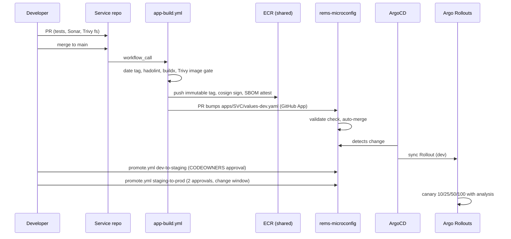

# Deployment Workflow (end-to-end)

**Status:** ✅ Designed and implemented in code. ⚠️ Never run end-to-end.



Branching model behind this flow: [Git branching strategy](git-branching-strategy.md).

## Promotion rules

| Env | Who changes the tag | Approval | Delivery |
|---|---|---|---|
| dev | CI bot (auto-merge) | none | Rollout disabled by default in dev values (plain Deployment) |
| staging | `promote.yml` PR | CODEOWNERS (platform) | Canary + analysis |
| prod | `promote.yml` PR | CODEOWNERS (platform + SRE), `validate` requires 2 approvals for prod paths | Canary + analysis, ArgoCD sync window |
| prod-dr | Inherits `values-prod.yaml` + DR overrides | – | Synced continuously (warm standby) |

The promotion copies the **same tag and digest**. Nothing is rebuilt between environments.

## Commands

```bash
# Promote
gh workflow run promote.yml -R <org>/rems-microconfig -f service=rems-api -f path=dev-to-staging
gh pr list -R <org>/rems-microconfig --label promote
# Load test staging before going to prod
gh workflow run load-test.yml -f scenario=normal-load -f base_url=https://app.staging.rems.example.com   # placeholder host
gh workflow run promote.yml -R <org>/rems-microconfig -f service=rems-api -f path=staging-to-prod
# Watch prod
kubectl argo rollouts get rollout rems-api -n rems --watch
```

`load-test.yml` inputs: `scenario` (normal-load, peak-5x, spike-10x, db-bottleneck, ai-provider-failure, redis-failure, az-failure) and `base_url`.

## Canary analysis (`cicd/argo-rollouts/analysis-templates.yaml`)

| ClusterAnalysisTemplate | Success condition | failureLimit |
|---|---|---|
| `rems-http-error-rate` | error ratio < 1 % (or no data) | 1 |
| `rems-http-latency-p95` | p95 < 0.5 s (or no data) | 1 |
| `rems-pod-restarts` | restarts < 1 | 0 |

"No data counts as success" is deliberate, so a low-traffic env isn't blocked. In prod, combine it with the k6 synthetic traffic or raise the bar.

## Verification

* The microconfig PR is linked to the source commit and shows the digest.
* `argocd app get rems-prod-rems-api` shows the new revision.
* The rollout reaches `Healthy` at 100 %.
