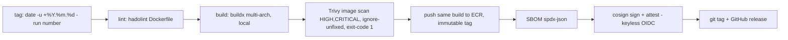

# Docker Build

**Status:** ✅ Build steps in `.github/workflows/app-build.yml` (jobs `tag`, `lint`, `build`). 🟡 Dockerfiles live in the service repositories, which aren't available here. Nothing about them is assumed beyond the inputs `context` (default `.`) and `dockerfile` (default `Dockerfile`).

## Objective

Reproducible multi-arch images (`linux/amd64,linux/arm64`, so Graviton nodes work), tagged with an immutable date tag, and never pushed before they pass the vulnerability gate.

## Pipeline order (merge to main)



Tag format: `YYYY.MM.DD-<GITHUB_RUN_NUMBER>`, for example `2026.11.22-418`. Generated by:

```bash
echo "tag=$(date -u +%Y.%m.%d)-${GITHUB_RUN_NUMBER}" >> "$GITHUB_OUTPUT"
```

## Local build (same flags as CI)

```bash
docker buildx create --use --name rems || docker buildx use rems
TAG="$(date -u +%Y.%m.%d)-local"
docker buildx build --platform linux/amd64 -t rems-api:${TAG} --load -f Dockerfile .
hadolint Dockerfile
trivy image --severity HIGH,CRITICAL --ignore-unfixed --exit-code 1 rems-api:${TAG}
```

`--load` supports one platform at a time. CI builds both platforms.

## Image requirements imposed by the platform

| Requirement | Enforced by |
|---|---|
| Runs as non-root UID (charts use 10001) | Pod `securityContext`, PSS restricted, Kyverno |
| Works with a read-only root filesystem (writes to `/tmp` only) | Chart `readOnlyRootFilesystem: true` |
| Handles SIGTERM within 45 s | `terminationGracePeriodSeconds` |
| Signed by the CI identity | Kyverno `verifyImages` policy |
| Pulled from ECR only | Kyverno policy |

## Verification

```bash
aws ecr describe-images --registry-id <shared-acct> --repository-name rems/rems-api \
  --image-ids imageTag=<tag> --query 'imageDetails[0].{digest:imageDigest,pushed:imagePushedAt}'
docker buildx imagetools inspect <registry>/rems/rems-api:<tag>     # both architectures listed
```

## Troubleshooting

| Symptom | Fix |
|---|---|
| `exec format error` on Graviton nodes | Image built for amd64 only. Keep `platforms` at the default |
| Trivy gate fails | Upgrade the base image / package. Accept only with a documented `.trivyignore` entry |
| `tag invalid: The image tag already exists` | Immutable tags. The run number makes tags unique, so a re-run of the same run collides. Re-run the whole workflow instead |

## Rollback

Images are immutable. Rollback means pointing GitOps at the previous tag ([rollback procedure](rollback-procedure.md)).
