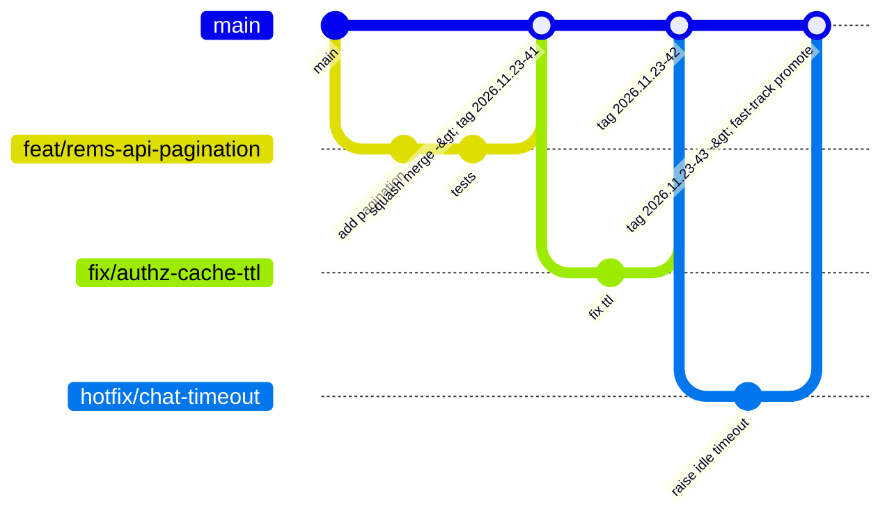
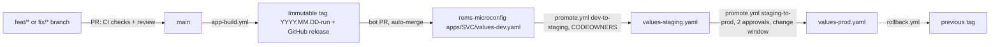

# Git Branching Strategy

**Status:** ✅ The rules behind this strategy are already implemented: `main`-only triggers in the workflows, branch protection on `rems-microconfig` (`terraform/cicd/github/main.tf`, resource `github_branch_protection.main`), immutable date tags and releases in `app-build.yml`, and environment approvals. 📋 Branch protection for the **platform** and **service** repositories is a one-time GitHub setting (commands below). It isn't managed by Terraform.

## Objective

Short-lived branches, one long-lived branch (`main`) per repository, and **environments represented by folders and immutable image tags, never by branches**. Every change to what runs in an environment is a reviewed, audited pull request.

## Model: trunk-based development + GitOps promotion

| Repository | Long-lived branch | Work branches | What a merge to `main` does |
|---|---|---|---|
| Platform repo (this one): Terraform, charts, policies, docs | `main` | `feat/*`, `fix/*`, `chore/*`, `docs/*`, `infra/*` | `terraform.yml` applies dev automatically, then staging and prod after environment approvals. ArgoCD picks up chart and add-on changes |
| Service repos (rems-api, chat-engine, …) | `main` | `feat/*`, `fix/*`, `hotfix/*` | `app-build.yml` builds, scans, signs, creates the date tag + GitHub release, and opens a PR in rems-microconfig for dev |
| `rems-microconfig` (GitOps values) | `main` | Bot branches from CI, `promote/*`, `rollback/*` created by the workflows | ArgoCD syncs the changed environment folder |

### Why not GitFlow or a branch per environment

* A `dev` / `staging` / `prod` branch per environment drifts: hot-fixes land on one branch and never reach the others, and merges between environment branches carry unrelated changes.
* With **folders per environment** (`apps/<svc>/values-<env>.yaml`) and **promotion that copies the exact tag + digest**, prod runs the same artifact that was tested in staging, and the diff of a promotion PR shows exactly one change.
* `release/*` branches aren't needed, because every merge to `main` produces an immutable, deployable artifact (`YYYY.MM.DD-<run>`).

## Flow



The tags in the graph only illustrate the format. Real tags are created by CI from the run number.



## Branch naming

| Prefix | Use | Example |
|---|---|---|
| `feat/` | New capability | `feat/karpenter-gpu-nodepool` |
| `fix/` | Bug fix | `fix/loki-retention-override` |
| `hotfix/` | Urgent production fix (service repos) | `hotfix/chat-engine-stream-timeout` |
| `infra/` | Terraform-only change | `infra/prod-aurora-reader-scaling` |
| `chore/` | Dependencies, tooling | `chore/bump-argo-cd-7.7.11` |
| `docs/` | Documentation only | `docs/dr-runbook-update` |
| `promote/`, `rollback/` | Created **only** by microconfig workflows | `promote/rems-api-staging-to-prod-…` |

Rules: lowercase, hyphen-separated, an issue key if you have one (`fix/REMS-123-...`). Delete the branch after merge (`delete_branch_on_merge = true` in `terraform/cicd/github/main.tf`).

## Commits and pull requests

* **Conventional Commits** in PR titles: `feat:`, `fix:`, `infra:`, `docs:`, `chore:`, `refactor:`, `test:`. With squash merge, the PR title becomes the commit message on `main`.
* **Squash merge** for feature branches. Linear history is required on `main`.
* PR template checklist: what changed and why, environments affected, `terraform plan` / render reviewed, rollback plan, docs updated.
* Keep branches short-lived (≤ 2 days). Use feature flags in the application for unfinished features rather than long-running branches.

## Required checks per repository

| Repository | Required status checks on `main` | Reviews |
|---|---|---|
| Platform | `terraform.yml` job `Static checks`, `k8s-validate.yml` jobs `helm`, `kustomize`, `policy`, `Kyverno admission policies vs. prod manifests` | CODEOWNERS (platform team; security team for `security/**`, IAM and SCP files), 1 approval, stale approvals dismissed |
| Service repos | `test`, `quality` (Sonar), `scan-source` (Trivy fs) from `app-build.yml` | 1 approval, CODEOWNERS |
| rems-microconfig | `validate` (YAML, tag/digest format, no `:latest`, prod tag = staging tag, 2 approvals for prod paths) | CODEOWNERS: platform for staging, platform + SRE for prod. The bot's dev PRs need none |

Common settings for all three: no force pushes, no deletion of `main`, linear history, conversation resolution required, admins included. Signed commits are optional (`require_signed_commits`). Turn them on once all bots commit through the GitHub API.

## Steps: apply branch protection

**rems-microconfig**: managed by Terraform:

```bash
cd terraform/cicd/github
terraform plan -out=tfplan && terraform apply tfplan     # resource github_branch_protection.main
```

**Platform and service repositories** (📋 one-time, run as a repo admin):

```bash
OWNER=<github-user-or-org>; REPO=<repo-name>
cat > /tmp/protection.json <<'EOF'
{
  "required_status_checks": { "strict": true, "contexts": ["Static checks", "helm", "kustomize", "policy"] },
  "enforce_admins": true,
  "required_pull_request_reviews": {
    "dismiss_stale_reviews": true,
    "require_code_owner_reviews": true,
    "required_approving_review_count": 1
  },
  "restrictions": null,
  "required_linear_history": true,
  "allow_force_pushes": false,
  "allow_deletions": false,
  "required_conversation_resolution": true
}
EOF
gh api -X PUT "repos/$OWNER/$REPO/branches/main/protection" --input /tmp/protection.json
gh api -X PATCH "repos/$OWNER/$REPO" -F allow_squash_merge=true -F allow_merge_commit=false \
  -F allow_rebase_merge=false -F delete_branch_on_merge=true
```

`contexts` uses the check-run names, which are the job `name:` values in the workflows (`Static checks` in `terraform.yml`; `helm`, `kustomize`, `policy` in `k8s-validate.yml`). Both workflows have `paths:` filters, so a PR that only touches `docs/**` doesn't run them, and a **required** check that never runs blocks the merge. Either remove the `paths:` filter from the `pull_request` trigger, or add a small always-running workflow with jobs of the same name. Open one PR and compare the names in its checks list before applying. For service repos, use their own check names (for example `test`).

`.github/CODEOWNERS` still uses the placeholder org `your-github-org`. Replace it with your user or team handles, or CODEOWNERS review can't be satisfied.

## Hotfix flow

1. Branch `hotfix/<summary>` from `main`. Open a PR with the `hotfix` label. Reviewers fast-track it, but the same checks apply.
2. Merge. CI produces a new date tag.
3. Promote dev → staging → prod immediately with `promote.yml`. The prod change window can be overridden by on-call (ArgoCD `manualSync`), and the override is recorded in the incident.
4. If the fix can't wait for a build, roll back first ([rollback procedure](rollback-procedure.md)), then hotfix.

There are no hotfix branches off old releases: production always runs a tag built from `main`, so the fix goes to `main` and forward.

## Versioning and tags

| Artifact | Version | Created by |
|---|---|---|
| Container images | `YYYY.MM.DD-<run number>` (immutable in ECR) + digest | `app-build.yml` job `tag` |
| Service releases | Git tag + GitHub release with the same name | `app-build.yml` (`gh release create`) |
| Helm charts | `version` in `Chart.yaml` (SemVer), bumped when templates change | Platform PR |
| Reusable workflow | Service repos call `app-build.yml@main`. Pin to a tag (`@v1`) once stable | Platform maintainers |
| Terraform modules | Referenced by relative path (same repo), so no separate versioning | – |

## Verification

```bash
gh api repos/<owner>/<repo>/branches/main/protection --jq '{checks: .required_status_checks.contexts, linear: .required_linear_history.enabled, admins: .enforce_admins.enabled}'
gh api repos/<owner>/<repo> --jq '{squash: .allow_squash_merge, merge: .allow_merge_commit, delete_branch: .delete_branch_on_merge}'
git push origin main      # should be rejected: "protected branch hook declined"
```

## Rollback

Code: `git revert` through a PR (never force-push `main`). Running version: [rollback procedure](rollback-procedure.md). Branch protection itself: re-run the `gh api` command with the previous JSON, or `terraform apply` for microconfig.
