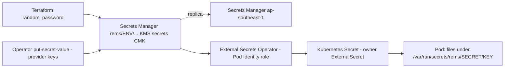

# Secrets Management

**Status:** ✅ Secrets Manager secrets created by Terraform (DB service logins, Redis AUTH, LLM key placeholders), External Secrets Operator (`kubernetes/base/external-secrets.yaml`, chart `externalSecrets` values), rotation script for DB logins. 🟡 Master-password rotation flag and Redis rotation are documented procedures, not scripts. ⚠️ Not applied.

## Objective

No secret in Git, container images, Terraform variables files or environment variables. One source of truth (Secrets Manager), encrypted with a CMK, replicated to DR, delivered to pods as files.

## Secret naming (real paths)

| Secret | Name | Created by |
|---|---|---|
| Aurora service login | `rems/<env>/aurora/rems-<env>-<core\|rag>/<service>` | `modules/aurora-postgresql` (random password) |
| Aurora master | `rems/<env>/aurora/rems-<env>-<core\|rag>/master` | same |
| Valkey AUTH | `rems/<env>/redis/rems-<env>-cache` | `modules/elasticache-redis` |
| LLM provider keys | `rems/<env>/llm/<provider>` (openai, anthropic) | `modules/ai-platform` (**empty** container, value set by an operator) |
| LLM gateway master key | `rems/<env>/llm/master-key` | same |

## Flow



## Steps

1. Set the provider keys. They never pass through Terraform state. Read them from a secure prompt, not shell history:

   ```bash
   read -rs OPENAI_KEY && aws secretsmanager put-secret-value --secret-id rems/prod/llm/openai --secret-string "$OPENAI_KEY"; unset OPENAI_KEY
   read -rs ANTHROPIC_KEY && aws secretsmanager put-secret-value --secret-id rems/prod/llm/anthropic --secret-string "$ANTHROPIC_KEY"; unset ANTHROPIC_KEY
   aws secretsmanager put-secret-value --secret-id rems/prod/llm/master-key --secret-string "$(openssl rand -hex 32)"
   ```

2. The ClusterSecretStore `aws-secrets-manager` (region patched per overlay) authenticates with the ESO Pod Identity role (`module "irsa_external_secrets"`).

3. Each chart declares its secrets (real excerpt, `helm/charts/rems-api/values-prod.yaml`):

   ```yaml
   externalSecrets:
   - name: rems-api-db
     remoteKey: rems/prod/aurora/rems-prod-core/rems-api
     refreshInterval: 1h
     envFrom: false
   ```

4. Rotation: `database/scripts/rotate-service-password.sh <env> <core|rag> <service>` (zero downtime: AWSPENDING → `ALTER ROLE` → AWSCURRENT). The full matrix is in `security/secrets-rotation.md`.

   🟡 `security/secrets-rotation.md` mentions a `--master` option. The script doesn't implement it (it only *reads* the master secret to connect). Rotate the master through RDS (`aws rds modify-db-cluster --manage-master-user-password` is not used by this module) or extend the script. Tracked in [IMPLEMENTATION-STATUS](../IMPLEMENTATION-STATUS.md).

## Verification

```bash
aws secretsmanager list-secrets --filters Key=name,Values=rems/prod/ --query 'SecretList[].{n:Name,rot:RotationEnabled,repl:ReplicationStatus[0].Region}'
kubectl get externalsecrets -A
kubectl describe externalsecret rems-api-db -n rems | grep -A3 Conditions
```

Expected: `SecretSynced` / `Ready=True`. Never print secret values in a terminal that is recorded.

## Security considerations

* The Secrets Manager resource policy and the Pod Identity roles limit each service to its own paths.
* Generated passwords live in Terraform state, which is encrypted (KMS) and access-restricted.
* `deletionPolicy: Retain` on ExternalSecrets: deleting the CR doesn't break running pods.
* Emergency revocation: new version → `kubectl annotate externalsecret <name> force-sync=$(date +%s) -n <ns> --overwrite` → `kubectl argo rollouts restart <svc> -n <ns>`.

## Troubleshooting

| Symptom | Fix |
|---|---|
| `SecretSyncedError ... AccessDeniedException` | ESO role policy is missing the path, or there is no KMS decrypt grant on the secrets CMK |
| `ResourceNotFoundException` | Typo in `remoteKey`, or the environment's secret doesn't exist yet |
| App can't find credentials | The app expects env vars. Map them via `extraEnv` / `envFrom: true` once the real variable names are known (P6) |

## Rollback

Secrets Manager keeps previous versions. Restore with:

```bash
aws secretsmanager update-secret-version-stage --secret-id <id> --version-stage AWSCURRENT \
  --move-to-version-id <previous-version-id> --remove-from-version-id <current-version-id>
```
