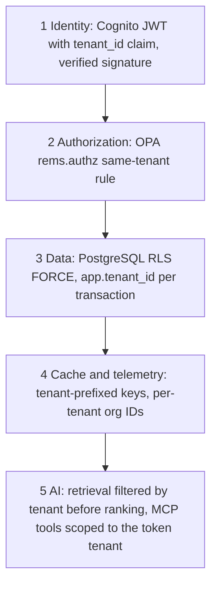

# Tenant Isolation

**Status:** ✅ Database RLS (`database/sql/03-row-level-security.sql`, `04-pgvector-rag.sql`), OPA policy (`security/opa/tenant_isolation.rego`, unit-tested), Cognito `tenant_id` claim design, LLM gateway per-tenant budgets. 🟡 Application enforcement (setting `app.tenant_id` per transaction, passing the tenant to OPA) must be implemented in the service code, which isn't in this repository. ⚠️ Not tested end-to-end.

## Model

Pooled multi-tenancy (shared services and databases) with **five isolation layers**. Any single layer failing doesn't expose another tenant's data.



## Layer 3 in detail (real SQL)

```sql
-- every transaction, tenant taken from the verified JWT
SELECT set_config('app.tenant_id', '<uuid from verified JWT>', true);

ALTER TABLE rems.incidents FORCE ROW LEVEL SECURITY;
CREATE POLICY tenant_isolation ON rems.incidents ...
-- helper used by the policies:
--   SELECT NULLIF(current_setting('app.tenant_id', true), '')::uuid
```

`FORCE` makes the policy apply to the table owner too, so migrations can't accidentally read across tenants. With no `app.tenant_id` set, the helper returns NULL and the policy matches no rows (fail closed).

## Test it (any PostgreSQL 16 with the scripts applied)

```bash
psql "$DSN" -v ON_ERROR_STOP=1 <<'SQL'
BEGIN;
SELECT set_config('app.tenant_id', '11111111-1111-1111-1111-111111111111', true);
SELECT count(*) FROM rems.incidents;   -- only tenant 1111... rows
ROLLBACK;
BEGIN;
SELECT count(*) FROM rems.incidents;   -- 0 rows: no tenant set
ROLLBACK;
SQL
opa test security/opa -v              # includes cross-tenant deny cases
```

## Detection

* The authorization deny-burst alarm (`modules/monitoring`, `authz_deny_threshold`).
* Audit events (schema in `security/audit-logging.md`).
* Runbook: `runbooks/cross-tenant-access-attempt.md`.

## Silo option

📋 For regulated tenants: a dedicated Aurora cluster, or a dedicated namespace and node pool. Designed in `architecture/07-security.md`, not implemented.

## Rollback

RLS policy changes are SQL migrations. Ship them forward-only with a tested down-migration. Never disable RLS in production to "fix" a query.
