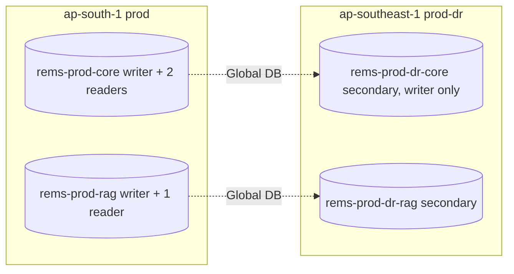

# Database Disaster Recovery

**Status:** ✅ Aurora Global Database (primary prod → prod-dr), secret replicas, DR KMS keys, backup copies, `database/scripts/aurora-failover.sh`, `runbooks/dr-regional-failover.md`. ⚠️ Never failed over.

## Targets

RPO 15 min / RTO 2 h for critical services (PDF). Aurora Global DB typically replicates with < 1 s lag, well inside the RPO.

## Topology



Until `dr_promoted = true`, the DR clusters have 0 readers and no RDS Proxy, to keep cost down (`terraform/modules/rems-environment/data.tf`).

## Procedures (`database/scripts/aurora-failover.sh`)

| Scenario | Command | Data loss |
|---|---|---|
| AZ drill (in-region writer failover) | `./database/scripts/aurora-failover.sh az-test rems-prod-core` | none |
| Planned regional switchover | `./database/scripts/aurora-failover.sh switchover <global-id> <secondary-cluster-arn>` | none (RPO 0) |
| Unplanned regional failover | `./database/scripts/aurora-failover.sh failover <global-id> <secondary-cluster-arn>` | replication lag at the time of failure |

Get the IDs:

```bash
terraform -chdir=terraform/environments/prod output -json aurora | jq '{core_global_id, rag_global_id}'
aws rds describe-global-clusters --query 'GlobalClusters[].{id:GlobalClusterIdentifier,members:GlobalClusterMembers[].{arn:DBClusterArn,writer:IsWriter}}'
```

After a regional failover, scale the DR site:

```bash
cd terraform/environments/prod-dr
# set dr_promoted = true in terraform.tfvars (adds readers + RDS Proxy)
terraform init -reconfigure -backend-config=backend-dr-region.hcl   # if ap-south-1 (and its state bucket) is down
terraform plan -out=tfplan && terraform apply tfplan
```

The full sequence (DNS, ArgoCD, scaling, communication) is in `runbooks/dr-regional-failover.md` and [recovery runbook](../11-ha-dr/recovery-runbook.md).

## Verification

```bash
aws rds describe-global-clusters --global-cluster-identifier <global-id> \
  --query 'GlobalClusters[0].GlobalClusterMembers[].{arn:DBClusterArn,writer:IsWriter}'
aws cloudwatch get-metric-statistics --namespace AWS/RDS --metric-name AuroraGlobalDBReplicationLag \
  --dimensions Name=DBClusterIdentifier,Value=<secondary-cluster-id> --start-time <ISO> --end-time <ISO> --period 60 --statistics Maximum
```

## Rollback / failback

After the primary region recovers, the old primary rejoins as a secondary (switchover) or must be re-added. Then do a planned `switchover` back during a change window, and set `dr_promoted = false` again.
