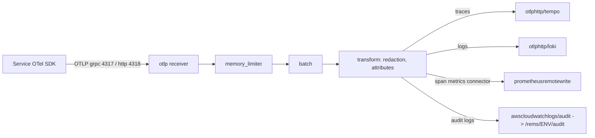

# OpenTelemetry

**Status:** ✅ Collector gateway (`monitoring/otel-collector/values.yaml`, contrib image, `mode: deployment`). Standard `OTEL_*` env vars injected by every chart. 🟡 SDK instrumentation is part of the service code (not in this repository). The audit exporter region and environment are placeholders.

## Pipelines (from the values file header)



## Environment injected into every REMS pod (real rendered output)

```yaml
- name: OTEL_SERVICE_NAME
  value: "rems-api"
- name: OTEL_EXPORTER_OTLP_ENDPOINT
  value: "http://otel-collector.observability.svc:4318"
- name: OTEL_EXPORTER_OTLP_PROTOCOL
  value: "http/protobuf"
- name: OTEL_TRACES_SAMPLER
  value: parentbased_traceidratio
- name: OTEL_TRACES_SAMPLER_ARG
  value: "0.1"
- name: OTEL_RESOURCE_ATTRIBUTES
  value: "deployment.environment=prod,service.namespace=rems,k8s.pod.name=$(K8S_POD_NAME),k8s.node.name=$(K8S_NODE_NAME),service.version=sha-0000000"
```

These are standard OpenTelemetry SDK variables, not REMS-specific names.

## Steps

1. Set `region` and `log_group_name` (`/rems/<env>/audit`) for `awscloudwatchlogs/audit`.
2. The collector service account gets `logs:PutLogEvents` through `module "irsa_otel_collector"`.
3. Commit. ArgoCD syncs at wave -5.

## Verification

```bash
kubectl -n observability get deploy otel-collector
kubectl -n observability port-forward deploy/otel-collector 13133:13133 && curl -s localhost:13133   # health_check
kubectl -n observability logs deploy/otel-collector | grep -i -E 'error|dropped' | tail
aws logs describe-log-streams --log-group-name /rems/prod/audit --max-items 5
```

## Troubleshooting

| Symptom | Fix |
|---|---|
| `memory_limiter` refusing data | Raise collector resources/replicas, or reduce volume |
| Exporter `401/403` to Loki/Tempo | Missing `X-Scope-OrgID` header |
| CloudWatch export fails | Pod Identity role / log group name mismatch |

## Rollback

Revert the values. Services buffer briefly and drop telemetry if the collector is down. Requests aren't affected.
