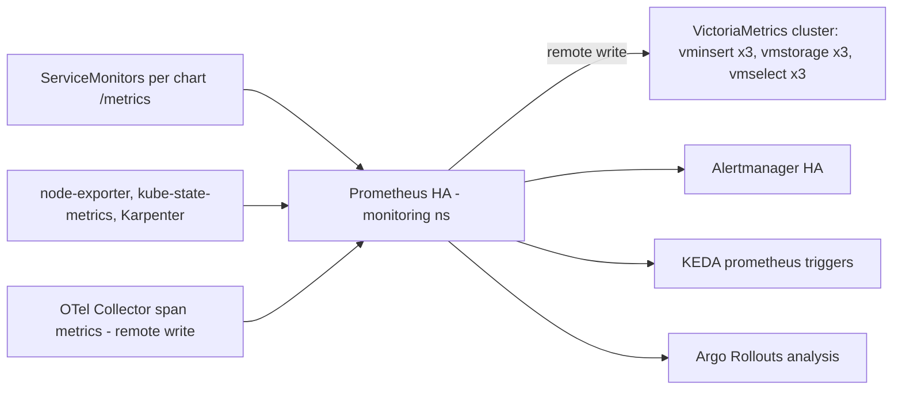

# Prometheus (kube-prometheus-stack) and VictoriaMetrics

**Status:** ✅ Values in `monitoring/kube-prometheus-stack/values.yaml` and `monitoring/victoria-metrics/values.yaml`. 114 recording/alerting rules in `monitoring/rules/*.yaml` pass `promtool check rules`. 🟡 SNS topic ARN, region, cluster name and Grafana OIDC settings are placeholders. ⚠️ Not deployed.

## Objective

Collect platform and REMS service metrics (Prometheus HA, 15-day local retention), keep them long-term in VictoriaMetrics (90 days, replication factor 2), and drive alerting and autoscaling.

## Architecture



## Key settings (real values)

| Setting | Value | File |
|---|---|---|
| Prometheus retention | `15d`, `retentionSize: 90GB` | `kube-prometheus-stack/values.yaml` |
| Alertmanager retention | `120h` | same |
| External label `cluster` | `PLACEHOLDER-cluster-name` → `rems-<env>` | same |
| VictoriaMetrics retention | `retentionPeriod: 90d` | `victoria-metrics/values.yaml` |
| VM replication | `replicationFactor: "2"` (survives loss of one vmstorage node or AZ) | same |
| Service address used by KEDA / Rollouts | `http://kube-prometheus-stack-prometheus.monitoring.svc:9090` | charts, `cicd/argo-rollouts/analysis-templates.yaml` |

## Steps

1. Replace the placeholders:

   ```bash
   grep -n PLACEHOLDER monitoring/kube-prometheus-stack/values.yaml
   ```

2. ArgoCD installs the stack at wave -10 and VictoriaMetrics at -5. Rules and dashboards come at wave -1.
3. Services are scraped through the `ServiceMonitor` each chart renders (label `release: kube-prometheus-stack`).

## Verification

```bash
kubectl -n monitoring get prometheus,alertmanager,servicemonitors
kubectl -n monitoring port-forward svc/kube-prometheus-stack-prometheus 9090:9090
# then open http://localhost:9090/targets (all REMS targets UP), /rules
promtool check rules <(yq '.spec' monitoring/rules/slo-rules.yaml)
```

## Security considerations

Prometheus is internal only (no Ingress). Scrape ingress to REMS pods is allowed only from Prometheus pods (`allow-telemetry` NetworkPolicy).

## Troubleshooting

| Symptom | Fix |
|---|---|
| Target `DOWN` | `/metrics` path or port placeholder wrong (P4), or the NetworkPolicy is missing |
| `out of order samples` on remote write | Duplicate senders with the same labels. Check the external labels per replica |
| High cardinality | `RemsActiveSeriesGrowth` alert. Drop labels in the collector or with relabeling |

## Rollback

Revert the values. Data in VictoriaMetrics persists across Prometheus rollbacks.
