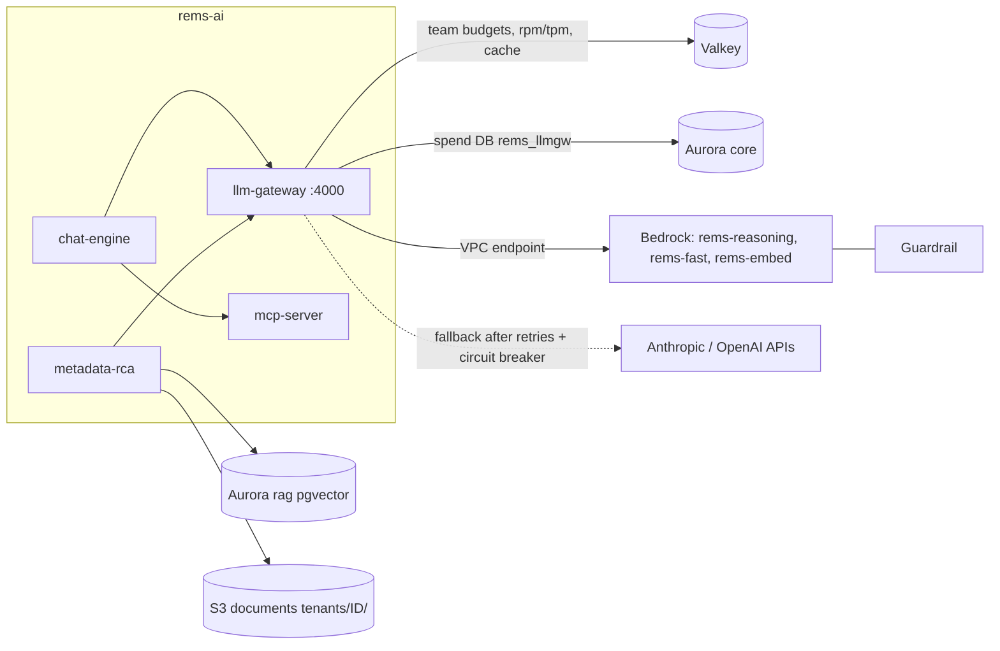

# AI Architecture

**Status:** ✅ Platform side implemented: Bedrock guardrail and invocation logging (`terraform/modules/ai-platform`), LLM gateway values + k8s components (`ai-infrastructure/llm-gateway/`), pgvector schema, MCP policy, AI alerts. 🟡 The AI application logic (RCA reasoning, chat orchestration, RAG pipeline code, MCP server) lives in the service repositories and isn't in this repo. 📋 The Network Firewall FQDN allow-list for external providers is planned only. ⚠️ Not deployed.

## Components

| Component | Implementation | Files |
|---|---|---|
| LLM gateway | LiteLLM (chart `ghcr.io/berriai/litellm-helm` `0.1.572`, ArgoCD wave 0). OpenAI-compatible API at `http://llm-gateway.rems-ai.svc:4000` | `ai-infrastructure/llm-gateway/values.yaml` |
| Primary provider | Amazon Bedrock through the `bedrock-runtime` VPC endpoint | `modules/ai-platform`, `modules/vpc` |
| Guardrails | Bedrock Guardrail (PII anonymize, secrets block, prompt-attack filter) | `modules/ai-platform` |
| Fallback providers | Anthropic API, OpenAI API (keys in Secrets Manager) | gateway values, `rems/<env>/llm/*` |
| RAG store | Aurora `rems-<env>-rag` + pgvector | `database/sql/04-pgvector-rag.sql` |
| Consumers | chat-engine, metadata-rca (never hold provider credentials) | Helm charts |
| Tools | mcp-server (read-only) | `ai-infrastructure/mcp/` |

## Diagram

## Capacity model (100 tenants, `ai-infrastructure/README.md`)

| Input | Result |
|---|---|
| 150 concurrent chat sessions | ~300 in-flight LLM calls |
| ~2 000 incidents/day × 4 calls × ~6k tokens | ~48 M tokens/day ≈ 33k TPM average, 165k TPM at 5× peak |
| Embeddings | < 30 M tokens/day, batched off-peak |
| Gateway | 1 pod ≈ 100 concurrent streams → 3–12 replicas |

These are planning estimates. Request Bedrock quota increases before onboarding tenants.

## Failure behaviour

Retries (2) → circuit breaker (`allowed_fails: 5`, `cooldown_time: 60`) → fallback model group → degraded non-LLM answer. Runbook: `runbooks/ai-provider-outage.md`. k6: `load-testing/k6/scenarios/ai-provider-failure.js`. Chaos: `load-testing/chaos/bedrock-endpoint-deny-policy.json`.

## Security

See [MCP security](../07-security/mcp-security.md) and [tenant isolation](../07-security/tenant-isolation.md). Gateway message logging is off. Bedrock invocation logs are KMS-encrypted. Tenants can opt out of external providers.
