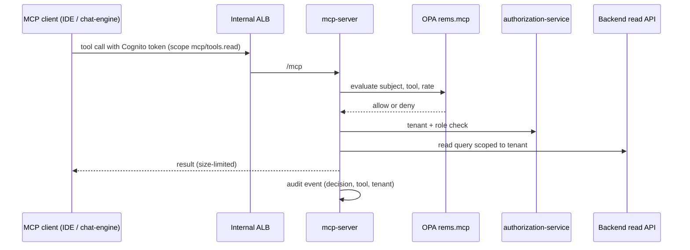

# MCP Server

**Status:** ✅ Deployment chart (`helm/charts/mcp-server`), tool catalog (`ai-infrastructure/mcp/tool-catalog.yaml`), OPA policy, RBAC, Kyverno guard. 🟡 Server code and the MCP transport details are in the service repository. ⚠️ Not deployed.

## Deployment facts (rendered prod chart)

| Item | Value |
|---|---|
| Namespace / node pool | `rems-ai` / general |
| Exposure | Internal ALB group `rems-internal`, path `/mcp` |
| Replicas | HPA 2–10, CPU 60 % |
| Kubernetes RBAC | Bound to `rems-k8s-observer` (read-only) through `mcp-server-observer` ClusterRoleBinding |
| AWS IAM | None |
| Egress | authorization-service, rems-api, observability read ports, kube-apiserver |

## Tool catalogue (read-only)

| Tool | Roles | Max range | Max rows |
|---|---|---|---|
| `query_metrics` | sre, incident-viewer, tenant-admin | 1440 min | 10 000 |
| `query_logs` | sre, tenant-admin | 360 min | 2 000 |
| `query_traces` | sre, tenant-admin | 360 min | 500 |
| `get_incident` | sre, incident-viewer, tenant-admin | – | 1 |
| `list_alerts` | sre, incident-viewer, tenant-admin | 1440 min | 500 |
| `describe_workload` | sre, tenant-admin | – | 50 |
| `search_sops` | sre, incident-viewer, tenant-admin | – | 20 |

(From `security/opa/mcp_tools.rego`. Keep `ai-infrastructure/mcp/tool-catalog.yaml` in sync.)

## Request flow



## Steps

1. Create the Cognito MCP client (`module "cognito"`, output `cognito.mcp_client_id`).
2. Promote the mcp-server image through microconfig like any service.
3. Give clients the internal URL over VPN: `https://<internal-host>/mcp` (host placeholder).

## Verification

```bash
kubectl -n rems-ai get rollout mcp-server
kubectl auth can-i --list --as=system:serviceaccount:rems-ai:mcp-server | head
opa test security/opa -v
```

## Rollback / kill switch

```bash
argocd app set rems-prod-mcp-server --sync-policy none
kubectl -n rems-ai scale rollout mcp-server --replicas=0
```

Follow `runbooks/compromised-mcp-tool.md`.
