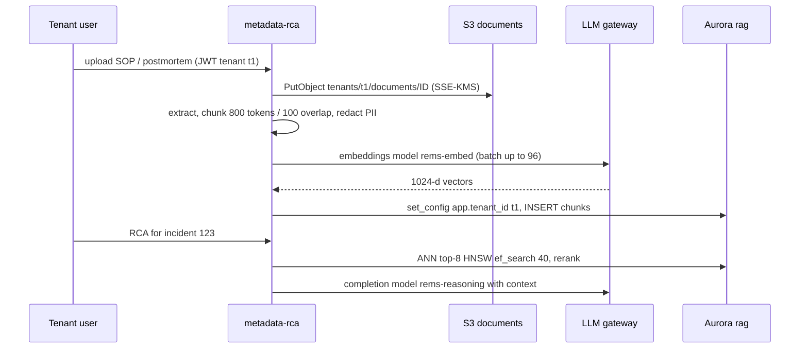

# RAG Implementation

**Status:** ✅ Storage and schema (S3 documents bucket with tenant prefixes, Aurora rag cluster, `database/sql/04-pgvector-rag.sql`), IAM (metadata-rca role limited to `tenants/*`), design in `ai-infrastructure/rag/README.md`. 🟡 Ingestion and retrieval code (chunking, redaction, re-ranking) belongs to metadata-rca and isn't in this repository.

## Pipeline



## Design decisions (from `ai-infrastructure/rag/README.md`)

| Topic | Decision |
|---|---|
| Vector store | pgvector on a dedicated Aurora cluster (same backups/DR/RLS as the rest). OpenSearch Serverless was rejected on cost and a second isolation model |
| Embeddings | Titan Text Embeddings v2, 1024 dimensions. The `model` column stores the version for re-embedding |
| Chunking | 800 tokens / 100 overlap, Markdown-aware |
| Dedup | `UNIQUE (tenant_id, sha256)` |
| Isolation | `tenant_id` + RLS on every table. Optional partial HNSW indexes for very large tenants |
| Privacy | PII redaction before embedding. Vectors never sent to external providers |
| Retention | Document delete cascades to chunks. S3 noncurrent versions expire after 90 days |

## Steps

1. Apply the environment (creates the rag cluster, the documents bucket `buckets.documents` and the metadata-rca Pod Identity role).
2. `./database/scripts/bootstrap-roles.sh <env> rag` creates `rems_savvy`, the pgvector extension, the `savvy` schema, the HNSW index and RLS.
3. Configure metadata-rca with the rag proxy endpoint (`aurora.rag_proxy_endpoint`) and the bucket name. These config keys are app-specific (pending).

## Verification

```sql
-- as rems_savvy, inside a transaction with app.tenant_id set
SELECT extname, extversion FROM pg_extension WHERE extname = 'vector';
SELECT indexname FROM pg_indexes WHERE schemaname = 'savvy';
EXPLAIN SELECT id FROM savvy.chunks ORDER BY embedding <=> '[...]'::vector LIMIT 8;   -- uses chunks_embedding_hnsw
```

Quality gate per release: recall@8 ≥ 0.8 on a labelled incident→SOP set (📋 dataset to be created).

## Operations

* Reindex: `REINDEX INDEX CONCURRENTLY savvy.chunks_embedding_hnsw` on the writer in a quiet window.
* Recall-critical queries: `SET LOCAL hnsw.ef_search = 100`.

## Rollback

Embedding model change: keep both versions (`model` column) until the re-embed is done, then delete the old rows.
