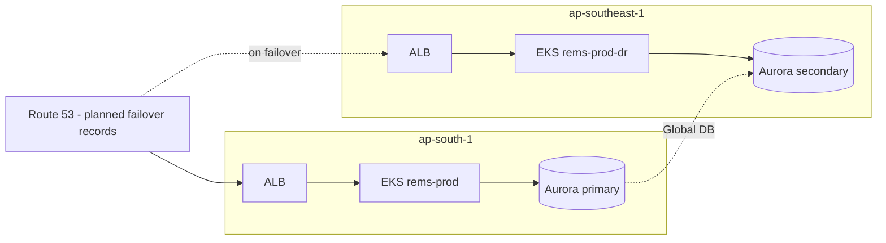

# Disaster Recovery

**Status:** ✅ Warm-standby DR site as code (`terraform/environments/prod-dr`, `cicd/argocd/apps/prod-dr`, `values-prod-dr.yaml`), data replication (Aurora Global DB, S3 CRR + RTC, Secrets Manager replicas, ECR replication, backup copies), runbook `runbooks/dr-regional-failover.md`. 📋 Route 53 failover records and health checks aren't created by Terraform (the runbook assumes them). ⚠️ No DR drill performed.

## Targets

| Metric | Target (PDF) | Design capability |
|---|---|---|
| RPO | 15 min | Seconds (Aurora Global DB lag), ≤ 15 min for S3 (RTC SLA) |
| RTO | 2 h (critical services) | ~75 min procedure budget (runbook) |

## Strategy: warm standby in ap-southeast-1

| Component | Steady state in DR | On failover |
|---|---|---|
| EKS `rems-prod-dr` | Running. Services synced by ArgoCD at minimal replicas | Remove the min-replica overrides, Karpenter scales |
| Aurora | Global DB secondaries, writer only, no proxy | `failover` / `switchover`, then `dr_promoted = true` adds readers + RDS Proxy |
| Valkey | Running, empty (cache) | Re-warms |
| S3 documents | CRR replica with RTC | Becomes primary |
| Secrets | Replicas | Used directly |
| ECR | Replicated images | Used directly |
| Terraform state | Replicated state bucket in DR | `backend-dr-region.hcl` (break-glass) |
| DNS | 📋 Route 53 failover routing | Switch to the DR ALB |

## To complete before relying on DR

1. 📋 Add Route 53 health checks and failover records (primary/secondary) for the app hostname. Neither exists in `terraform/modules/rems-environment/edge.tf` today.
2. 📋 Prepare the `dr-scale-up` PR in rems-microconfig described in the runbook.
3. 📋 Run a planned switchover drill (`aurora-failover.sh switchover`) in a change window, and measure the actual RTO.
4. Confirm Bedrock model availability and quotas in ap-southeast-1.

Procedure: [recovery runbook](recovery-runbook.md).
