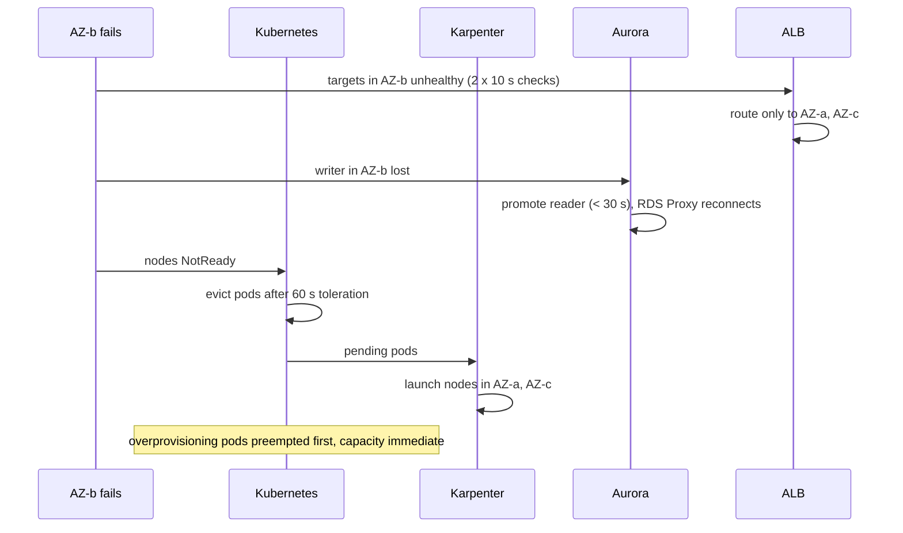

# High Availability

**Status:** ✅ Multi-AZ design implemented across Terraform, Kubernetes and Helm. ⚠️ Not validated by a real AZ-failure drill (FIS templates and k6 scenario are ready: `load-testing/chaos/fis-az-power-interruption.json`, `load-testing/k6/scenarios/az-failure.js`).

## Objective

99.95 % availability (≈ 21.6 min of downtime per 30 days) and automatic recovery from the loss of one Availability Zone, with no manual action.

## Per-layer design

| Layer | HA mechanism | Implemented in |
|---|---|---|
| Edge | ALB across 3 public subnets. WAF is regional and managed | Ingress annotations, `modules/waf` |
| NAT / egress | One NAT per AZ, app subnets route to their own AZ's NAT | `modules/vpc` (`single_nat_gateway = false`) |
| EKS control plane | AWS-managed, multi-AZ | – |
| System nodes | 3 × m7g.large across AZs, CoreDNS 3 replicas spread across zones | `modules/eks` |
| Workload nodes | Karpenter NodePools across 3 zones. Overprovisioning headroom (3 pause pods in prod) | `kubernetes/base/karpenter.yaml`, overlays |
| Pods | Topology spread (zone + host), PDBs, 60 s not-ready/unreachable tolerations, min replicas ≥ 2–6 in prod | `rems-common` |
| Deploys | Canary with `maxUnavailable: 0` and automatic analysis | Argo Rollouts |
| Aurora | Writer + 2 readers (core), writer + 1 reader (rag) in different AZs. Failover typically < 30 s, absorbed by RDS Proxy | `modules/aurora-postgresql` |
| Valkey | 3 shards × 1 replica, Multi-AZ automatic failover (~30–60 s) | `modules/elasticache-redis` |
| Observability | VictoriaMetrics replication factor 2, Loki/Tempo 3 replicas, Prometheus/Alertmanager HA, CloudWatch out-of-band alarms | `monitoring/` |
| GitOps | ArgoCD HA install | `cicd/argocd/install/values.yaml` |

## AZ failure: expected sequence



## Verification (staging drill)

```bash
./load-testing/chaos/run-chaos.sh az ap-south-1b
# pass criteria (load-testing/README.md): error < 0.5 % over 45 min, no manual action, p95 < 500 ms within 5 min
```

Record drill results in `load-testing/results/` (📋 none yet).

## Known limits

* A **regional** outage isn't covered by HA. See [disaster recovery](disaster-recovery.md).
* Cross-AZ capacity: with one AZ lost, the remaining two need ~50 % headroom. Karpenter provides it if EC2 capacity and vCPU quotas allow. Request quota increases ahead of time.
