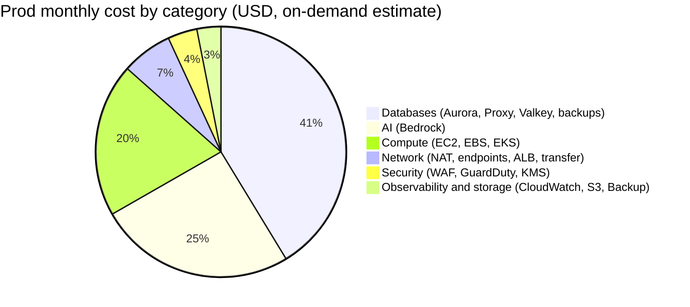

# Cost Breakdown (prod, on-demand)

From `python3 scripts/cost_model.py` (approximate list prices, see [estimation](aws-cost-estimation.md)).

| Service line | USD / month | Share |
|---|---:|---:|
| Bedrock LLM (tiered Sonnet/Haiku, 20 % cache hits) | 3,818 | 25 % |
| Aurora rems-core (3 × r7g.2xlarge I/O-Optimized + 500 GB) | 3,629 | 24 % |
| Aurora rems-rag (2 × r7g.xlarge I/O-Optimized + 300 GB) | 1,243 | 8 % |
| EC2 observability pool (4 × r7g.2xlarge) | 1,251 | 8 % |
| ElastiCache Valkey (6 × cache.r7g.large) | 832 | 6 % |
| EC2 general pool (avg 4 OD + 3 Spot m7g.xlarge) | 624 | 4 % |
| EC2 ai pool (3 × r7g.xlarge) | 469 | 3 % |
| RDS Proxy (2 proxies) | 438 | 3 % |
| VPC interface endpoints (16 × 3 AZ) | 415 | 3 % |
| EBS gp3 (~3.5 TB) | 319 | 2 % |
| CloudWatch | 300 | 2 % |
| WAF | 273 | 2 % |
| GuardDuty + Inspector | 260 | 2 % |
| NAT gateways (3) + 2 TB processed | 235 | 2 % |
| Data transfer out + cross-region replication | 233 | 2 % |
| EC2 system node group (3 × m7g.large) | 185 | 1 % |
| ALB (public + internal) | 105 | 1 % |
| Aurora backups + Global DB write I/O | 92 | 1 % |
| S3 | 92 | 1 % |
| AWS Backup | 75 | <1 % |
| EC2 workers (Spot) | 74 | <1 % |
| EKS control plane | 73 | <1 % |
| KMS + Secrets Manager | 40 | <1 % |
| Bedrock embeddings | 18 | <1 % |
| **Total** | **15,093** | 100 % |

The category totals are sums of the rows above (Databases = 3,629 + 1,243 + 92 + 438 + 832; Compute = 73 + 185 + 624 + 469 + 1,251 + 74 + 319; Network = 235 + 105 + 415 + 233; Security = 273 + 260 + 40; Observability/storage = 92 + 300 + 75; AI = 3,818 + 18).

Other environments: see the full table printed by the script (prod-dr 4,726 · staging 4,363 · dev 1,872 · shared/security 523).
