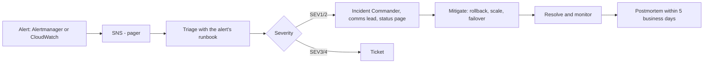

# Incident Management

**Status:** ✅ Alert → runbook mapping (`runbooks/README.md`), paging paths (Alertmanager → SNS, CloudWatch → SNS), SLO error-budget policy. 📋 On-call rota, status page and PagerDuty integration are organisational setup (`pagerduty_endpoint` is optional in `modules/monitoring`).

## Severity

| Sev | Definition | Response | Examples |
|---|---|---|---|
| SEV1 | Prod down or data exposure | Page immediately, IC assigned, status page within 15 min | Region failure, cross-tenant leak, fast burn 14.4× |
| SEV2 | Major degradation of a critical service | Page, respond within 30 min | 6× burn, AZ loss with impact, all LLM providers down |
| SEV3 | Minor or partial degradation | Ticket, next business day | Slow burn, single tenant issue |
| SEV4 | No user impact | Backlog | Warning alerts, cost anomalies |

## Flow

## First 15 minutes (SEV1/2)

1. Acknowledge the page, open the incident channel, assign an IC.
2. Freeze deploys: pause ArgoCD auto-sync for affected apps (`argocd app set <app> --sync-policy none`) or rely on the prod sync window.
3. Follow the alert's runbook (each alert carries `runbook_url`).
4. Prefer the fastest safe mitigation: rollout abort, scale-out, or failover. Diagnose root cause later.
5. Record every break-glass action (time, command, who) in the incident log.

## Security incidents

Cross-tenant access, compromised credentials or MCP misuse: involve the security on-call (`security_emails`). Preserve evidence before you change anything (audit logs, CloudTrail, pod logs). Follow `runbooks/cross-tenant-access-attempt.md` / `runbooks/compromised-mcp-tool.md`.

## Postmortem template (blameless)

Summary · impact (tenants, duration, error budget consumed) · timeline · root cause · what went well / poorly · action items with owners and dates. Link it from `docs/CHANGELOG.md` if it changes the platform.
