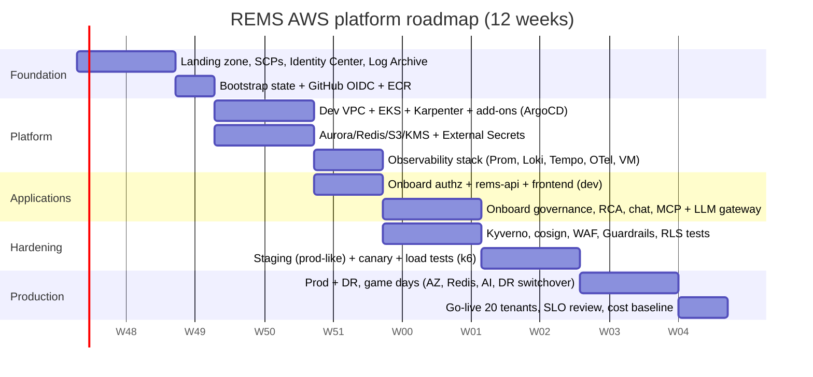

# Implementation Roadmap

Prioritised so that every phase leaves a usable, secure platform, and so that the riskiest items (tenant isolation, data durability, AI cost) are proven early.

| Phase | Weeks | Deliverables | Exit criteria |
|---|---|---|---|
| 0. Foundation | 1–2 | Organization, OUs, accounts, SCPs, Identity Center, Log Archive, GuardDuty/Security Hub org-wide, state buckets, GitHub OIDC, ECR | No IAM users. CloudTrail immutable. `terraform plan` for envs runs from CI |
| 1. Platform (dev) | 3–4 | VPC, EKS, Karpenter, ALB controller, ESO, KEDA, Rollouts, Kyverno (audit mode), Aurora, Valkey, S3, KMS | `scripts/smoke-test.sh` passes with a sample app. Node scale-out < 90 s |
| 2. Observability | 4–5 | kube-prometheus-stack, Loki, Tempo, OTel, VictoriaMetrics, dashboards, CloudWatch alarms | Self-monitoring dashboards live. Alert routing tested end to end |
| 3. App onboarding | 5–7 | Real ports, health paths and env vars from the service repos replace the placeholders. Authz → API → frontend, then governance, RCA, chat, MCP, LLM gateway | All 7 services healthy in dev. DB bootstrap automated |
| 4. Security hardening | 6–8 | Kyverno enforce, cosign verification, WAF tuning, Bedrock Guardrails, RLS + OPA test suites in CI, threat-model review, pen-test scope | Cross-tenant DAST suite green. No HIGH findings open |
| 5. Staging + performance | 8–10 | Prod-like staging, canary with analysis, k6 normal / 5× / 10× / db / AI / Redis / AZ | SLOs met at 5×. 10× spike recovered < 5 min. Requests re-baselined |
| 6. Production + DR | 10–11 | Prod + prod-dr, Global DB, CRR, backup vault lock, Route 53 failover, game days | AZ drill passes with no manual action. DR switchover within RTO 2 h, RPO ≤ 15 min |
| 7. Go-live & optimise | 12 | 20 tenants onboarded, error-budget policy active, Savings Plans/RIs after 4 weeks of data | 99.95 % over the first 30 days. Cost within ±15 % of the model |

## After go-live (to 100+ tenants)

1. Silo tier automation for regulated tenants (a dedicated Aurora cluster, KMS key and namespace from the same modules).
2. Service mesh mTLS (Istio ambient or VPC Lattice) for east-west authentication beyond NetworkPolicies.
3. Tenant-aware OTel ingest gateway with JWT-to-tenant header injection and per-tenant sampling.
4. Aurora Limitless / partitioning once the writer passes 60 % at the 5× peak.
5. Bedrock Provisioned Throughput once steady usage exceeds 60 % of the on-demand quota.
