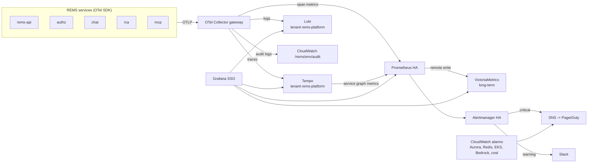

# REMS Monitoring and Observability

Two concerns, kept deliberately separate:

1. **Product observability data**: tenants' metrics, logs and traces that REMS analyzes. VictoriaMetrics, Loki and Tempo run in multi-tenant mode (`X-Scope-OrgID` / `accountID` = tenant).
2. **Self-monitoring of the REMS platform**: the `rems-platform` tenant, plus kube-prometheus-stack, plus an **independent CloudWatch path** that still pages when the in-cluster stack is down.



| PDF requirement | Where |
|---|---|
| Application metrics | ServiceMonitors (each chart) + OTel span metrics → Prometheus. Dashboard `rems-service-red` |
| Logs | OTel → Loki (structured, redacted). Trace-ID derived field links logs to traces |
| Traces | OTel → Tempo (30 d), tail noise filtered |
| SLOs | `slo/slos.md`, `rules/slo-rules.yaml` (98 rules), dashboard `rems-slo-overview` |
| Alerts | `rules/platform-alerts.yaml`, `rules/ai-alerts.yaml`, `rules/telemetry-cost-alerts.yaml` + Alertmanager routing (`kube-prometheus-stack/values.yaml`) + CloudWatch alarms (`terraform/modules/monitoring`) |
| Dependency mapping | Tempo metrics-generator `service-graphs` → Grafana service map / node graph |
| Infrastructure health | node-exporter, kube-state-metrics, Karpenter metrics, Container Insights, Aurora Performance Insights |
| Retention 30–90 days | Loki 30 d default (90 d per-tenant override), Tempo 30 d, VictoriaMetrics 90 d, S3 lifecycle expiry 90 d |

## Validation

```bash
promtool check rules <(yq '.spec' monitoring/rules/slo-rules.yaml)   # done in CI for every rule file
kubeconform -strict monitoring/rules monitoring/grafana/dashboards
```

## Cost levers (scenario: telemetry volume spike)

Per-tenant Loki `ingestion_rate_mb` and stream limits, Tempo `rate_limit_bytes`, VictoriaMetrics `maxLabelsPerTimeseries`, drop rules on remote-write, noise filters in the collector, S3 Intelligent-Tiering and lifecycle expiry, plus the `RemsTenantLogVolumeSpike` and `RemsActiveSeriesGrowth` alerts. See `runbooks/telemetry-cost-spike.md`.
