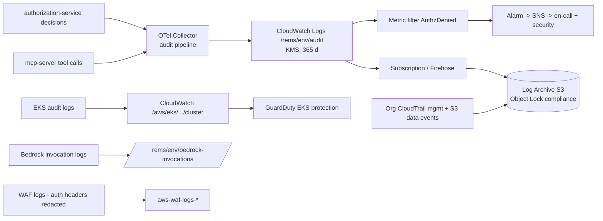

# Centralized Audit Logging



## Audit event schema (emitted by Authorization Service and MCP server)

```json
{
  "ts": "2026-11-21T10:15:02.123Z",
  "component": "mcp-server",
  "event": "tool_call",
  "decision": "deny",
  "severity": "high",
  "tenant_id": "t-acme",
  "subject": "u-123",
  "tool": "query_traces",
  "args_sha256": "9f2c…",
  "reasons": ["tenant scope mismatch (cross-tenant request)"],
  "trace_id": "4bf92f3577b34da6a3ce929d0e0e4736",
  "source_ip": "10.30.40.12"
}
```

Arguments are hashed rather than logged in full, so tenant data and secrets never reach the audit log while the call can still be correlated.

## Retention

| Log | Store | Retention | Tamper resistance |
|---|---|---|---|
| REMS audit (authz, MCP) | CloudWatch + Log Archive S3 | 1 y hot, 7 y archive | Object Lock compliance, SCP blocks `logs:DeleteLogGroup` |
| CloudTrail (org) | Log Archive S3 + CloudWatch copy | 7 y | Log file validation, Object Lock |
| EKS control plane (incl. audit) | CloudWatch | 90 d | KMS |
| VPC flow logs | Log Archive S3 (parquet) | 90 d → archive | Object Lock |
| WAF | CloudWatch | 90 d | KMS, auth/cookie redacted |
| Bedrock invocations | CloudWatch | 90 d | KMS, PII anonymized by Guardrails |
